<p align="center">
  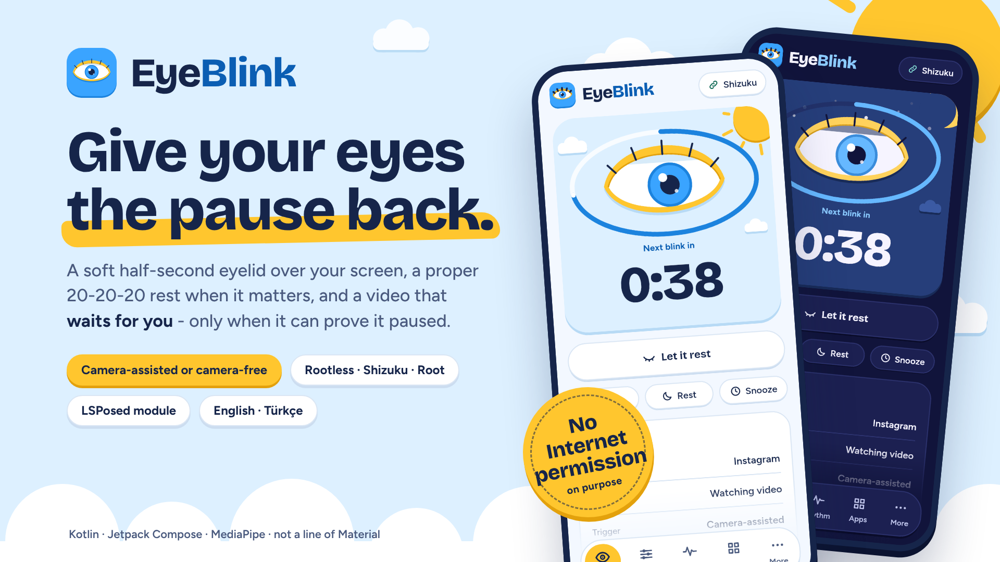
</p>

# EyeBlink

**Give your eyes the pause back.** EyeBlink is an Android app for the hours you spend staring at a feed.
Every so often it draws a soft, half-second eyelid over your screen - it closes, holds pure black, and opens - and now and then it asks
for a proper 20-20-20 rest. When it can *prove* it paused your video, it gives it back to you exactly where you left it.
When it can't, it says so instead of guessing.

> **Not a medical device.** EyeBlink does not replace blinking and does not treat dry eye. It gives you short, regular visual breaks.

> **Free for everyone, not for sale.** EyeBlink is source-available under the [PolyForm Noncommercial License 1.0.0](LICENSE): use it, change it and share it for any
> noncommercial purpose; nobody may sell it, wrap it in a paywall or ads, or build it into a commercial product. See [License](#license).

<p align="center">
  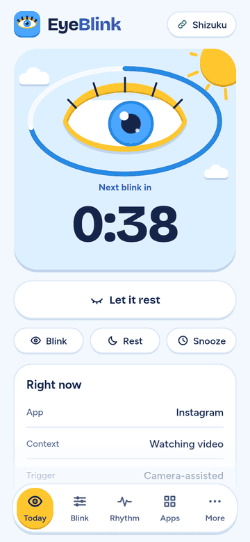
</p>

<table align="center">
  <tr>
    <td>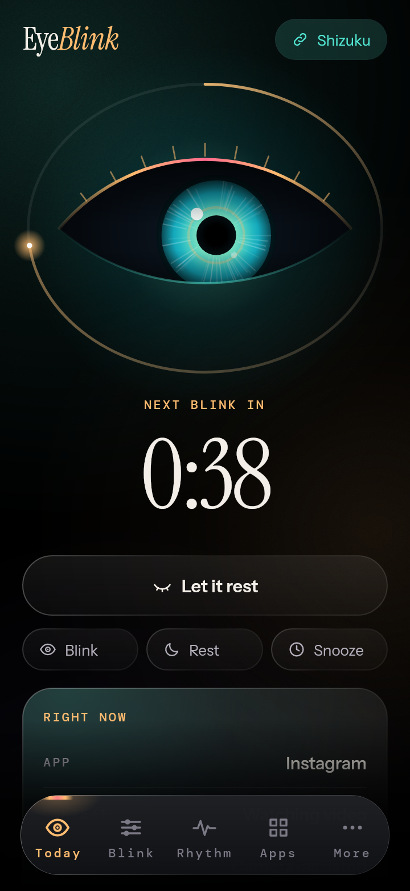</td>
    <td>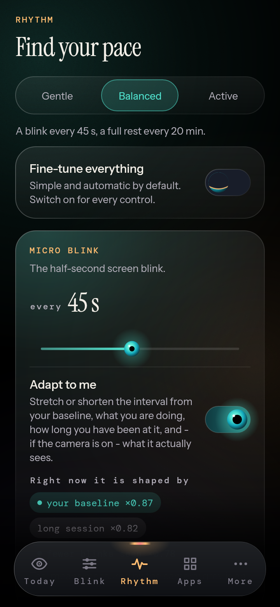</td>
    <td>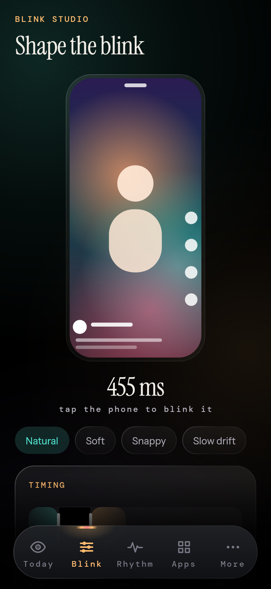</td>
    <td>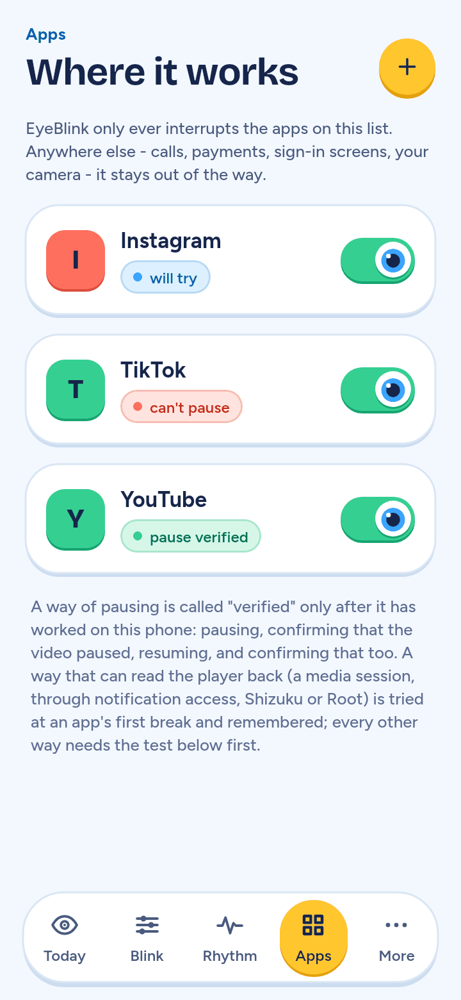</td>
    <td>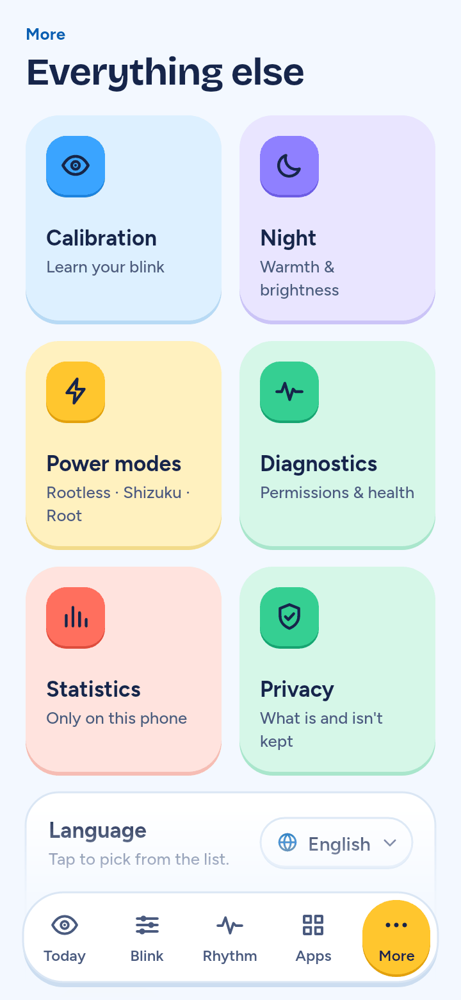</td>
  </tr>
  <tr>
    <td>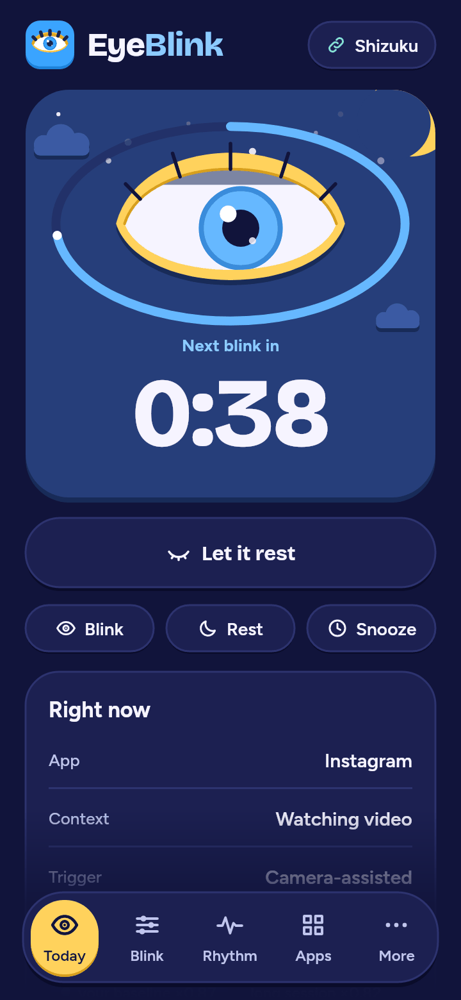</td>
    <td>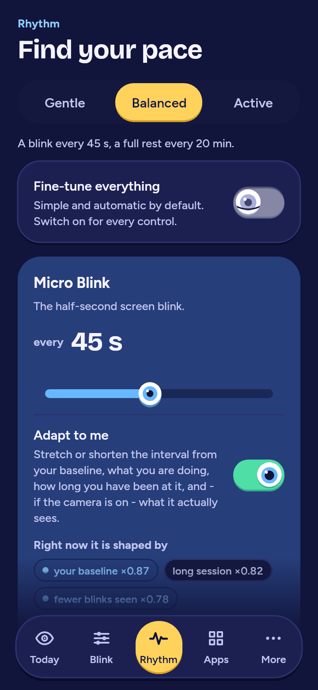</td>
    <td>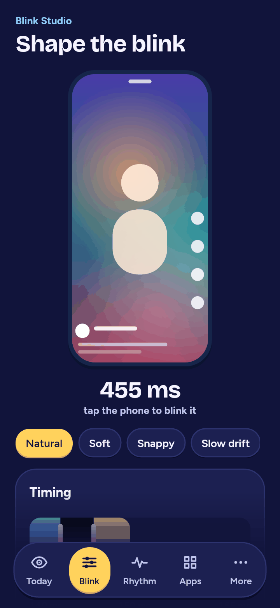</td>
    <td>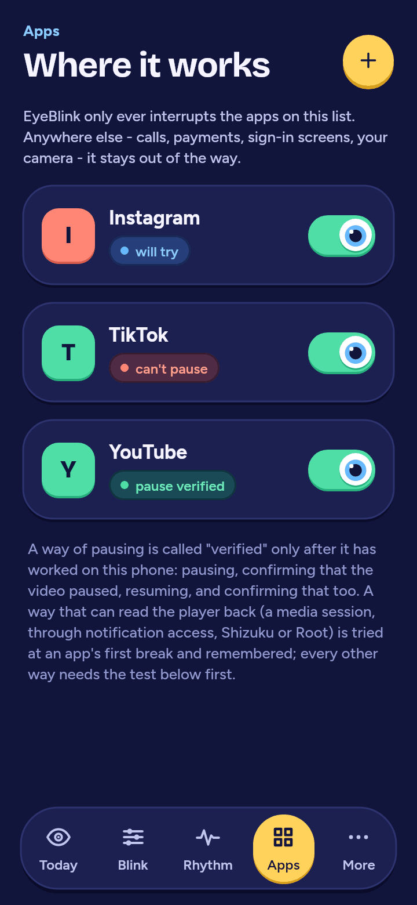</td>
    <td>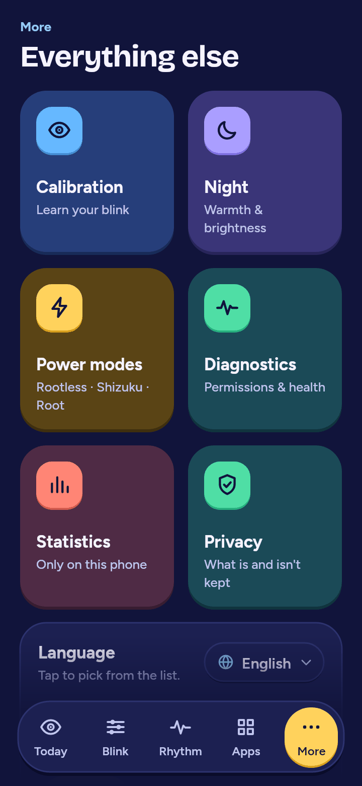</td>
  </tr>
  <tr>
    <td>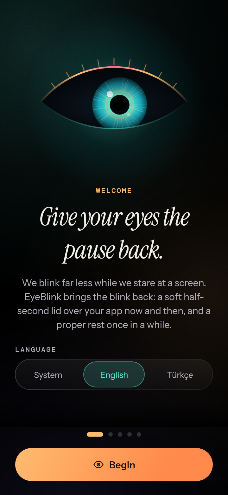</td>
    <td>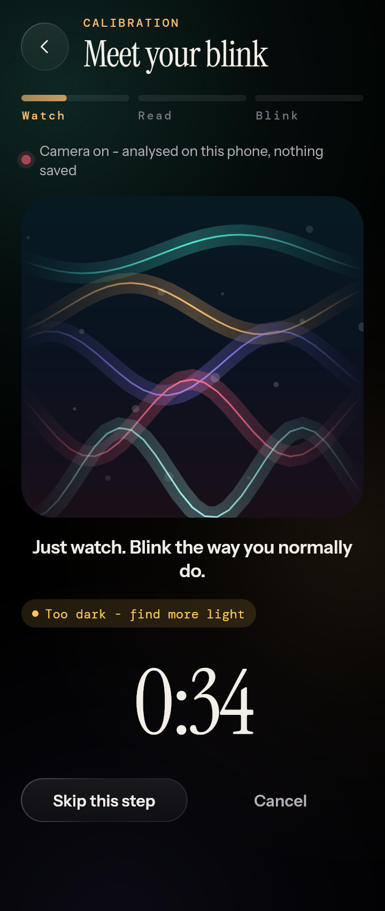</td>
    <td>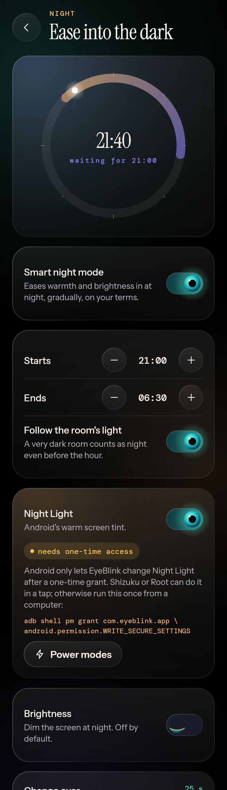</td>
    <td>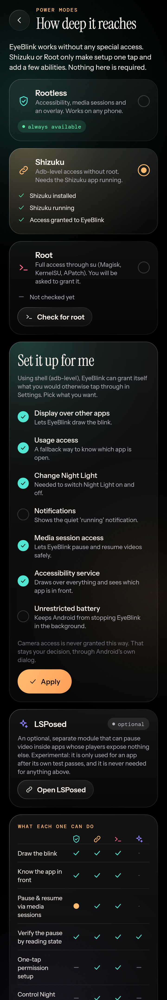</td>
    <td>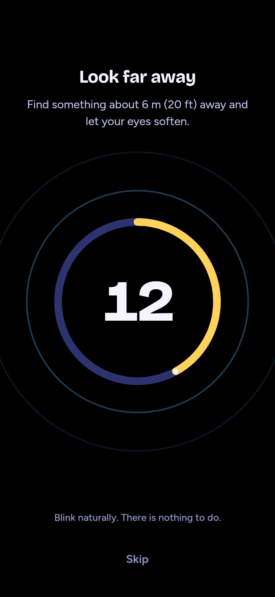</td>
  </tr>
  <tr>
    <td>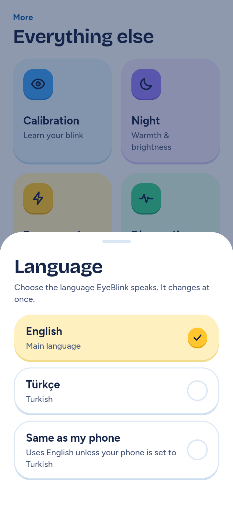</td>
    <td>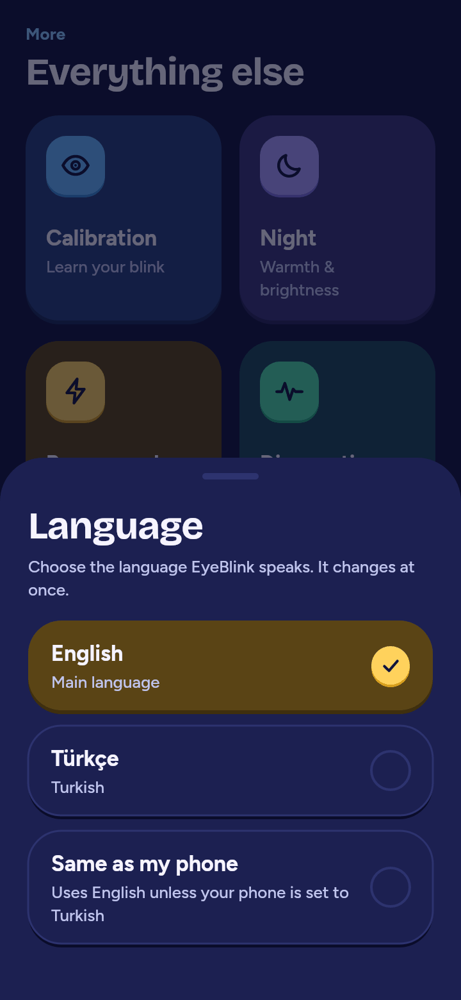</td>
    <td>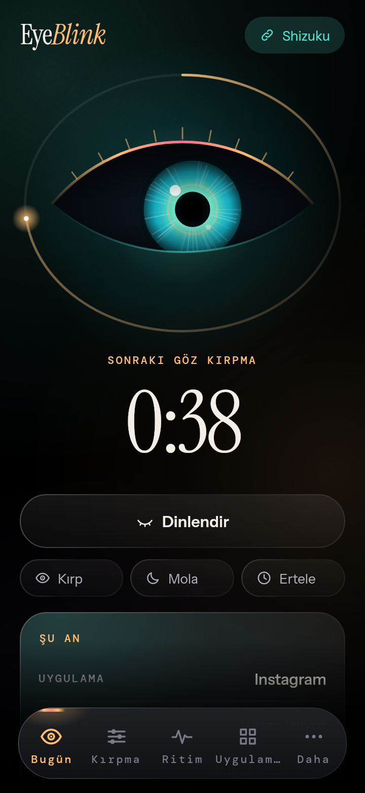</td>
    <td>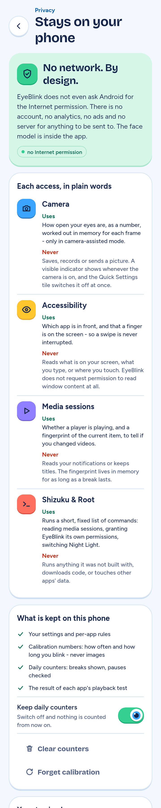</td>
    <td>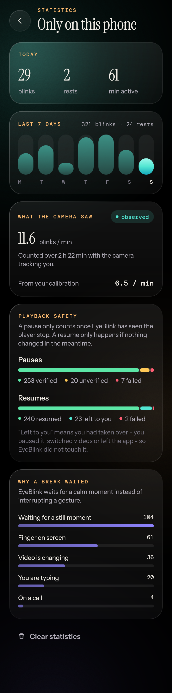</td>
  </tr>
</table>

*Every screenshot above is the app's real Compose UI, rendered headlessly on a laptop by the [design lab](tools/designlab) - not a mock-up.*

## What it does

- **A blink you can shape.** Curved eyelids close from the top and bottom, the screen darkens slightly, holds a pure `#000000` for a beat (on an OLED
  screen those pixels emit nothing), then reopens. 140 / 150 / 165 ms by default; every timing and curve is yours to change in Blink Studio, with a live
  preview on a stand-in feed. Reduced-motion mode fades instead of sweeping.
- **Camera-assisted or camera-free.** With the camera, EyeBlink watches how *you* blink (on-device, nothing stored) and paces itself accordingly.
  Without it, it runs on a smart timer - and never claims to have seen you blink.
- **It learns you.** A short guided calibration (watch, read, blink on purpose) gives it your baseline, with spontaneous and instructed blinks kept apart.
  It then keeps refining slowly from reliable moments only, per context (video, reading, scrolling, low light), and always labels what was *measured* and what is only *estimated*.
- **Two kinds of break.** *Micro Blink* is the half-second lid. *Smart Rest* is a longer, skippable pause - a pure-black Blackout or a Distance Focus
  countdown (look 6 m away for 20 s) - ended by a tap, or one real blink when the camera is on.
- **Videos wait for you - when it is safe.** EyeBlink pauses only after reading that something is playing, *verifies* the pause, and resumes only if nothing
  changed meanwhile. It never resumes what you paused yourself, never touches a video it cannot read, and tests each app on your phone (again after each app update) before relying on it.
- **Polite.** It waits out swipes, typing, calls, navigation and video transitions, keeps cool-downs and an hourly cap, and stays away from calls, payments, sign-in and system screens.
- **Smart night mode.** Optional, gradual warmth and brightness, driven by the clock and the room's light, which steps back the moment you change something yourself.
- **Simple or advanced.** Sensible automatic behaviour by default; one switch exposes every knob.
- **Two themes, two languages.** Bright *Daylight* and deep-indigo *Moonlit* (Auto / Light / Dark). English and Turkish, chosen from a chip that opens a list.

## Pick how deep it reaches

Nothing below the first row is required.

| | Rootless | Shizuku | Root | + LSPosed |
|---|:-:|:-:|:-:|:-:|
| Draw the blink, know the app in front | yes | yes | yes | |
| Pause and resume through media sessions | yes¹ | yes | yes | |
| Verify the pause by reading player state | yes | yes | yes | yes |
| One-tap permission setup | | yes | yes | |
| Control Night Light | | yes | yes | |
| Hook an app's own player | | | | yes² |

¹ needs the one-time notification-access permission. ² an optional second APK; experimental, and only used for an app after its own test passes.

## Status

This is an honest list. "Tested" means unit tests that run in CI; "built" means CI compiles and lints it; "on a phone" is something nobody has done yet.

| Part | State |
|---|---|
| Animation timeline, eyelid geometry, scheduling, interruption gates, rest state machine | **Tested** (more than 560 JVM tests in `:core`) |
| Playback safety protocol (pause, verify, remember, decide, resume, retry), per-app compatibility policy, and a whole break on a modelled phone with root whose shell and players answer slowly | **Tested** |
| Calibration maths, tracking pipeline, adaptive learning, night planner, usage and battery ledgers | **Tested** |
| Shell command building, quoting and `dumpsys media_session` parsing; settings codec | **Tested** |
| The whole UI - every screen in both themes | **Rendered** by the design lab on every CI run |
| Android layer: engine, overlay, accessibility, notification listener, foreground service, tile, camera, Shizuku/root bridge | **Built and linted** by CI |
| LSPosed module | **Built and linted** by CI |
| Anything that needs a real device: the overlay on top of real apps, MediaPipe on real faces, media sessions of real video apps, Shizuku/root commands and `dumpsys` on real output, the LSPosed hooks, foreground-service rules on Android 14+, battery numbers | **Not run on a phone yet** |
| MediaProjection screen analysis | **Not wired** - the change detector is implemented and tested; the capture is not |

Known limits you should know about before trusting it:

- **Many short-video apps publish no usable media session.** For those, no rootless strategy can be verified, so EyeBlink follows your chosen fallback (blink anyway, wait for the next swipe, or skip the app).
- **It cannot see your finger lift.** Android only lets it see the *start* of a touch outside its own window, so it waits out a debounce window instead.
- **The camera runs in short bursts.** Since Android 14 a camera foreground service cannot be started from the background.
- **On an LCD screen the backlight stays on** during the black hold. EyeBlink says so rather than implying the OLED effect.
- **The pacing is a product heuristic, not medicine.** People who blink less often than average are given *shorter* gaps between breaks, within a bounded range (see `personalIntervalScale` in `BlinkStatistics`).

The reasoning behind each of these is in [docs/FEASIBILITY.md](docs/FEASIBILITY.md).

## Try it

Every push is built by GitHub Actions. Open the latest run of **Android CI** and download one of its artifacts:

- **`eyeblink-release-arm64`** - the release APK for `arm64-v8a`, which is nearly every phone (about 15 MB).
- **`eyeblink-debug-arm64`** - the debug build. It installs next to the release as `com.eyeblink.app.debug`, is not minified, and its crash logs read like the source.
- **`eyeblink-apk`** - everything: debug and release APKs per ABI (12 MB `armeabi-v7a`, 18 MB `x86_64` for emulators), a 27 MB App Bundle and the optional LSPosed module.

A second job, **Start it on an emulator**, installs the debug build and a *minified* one (the release build as R8 leaves it, which is where reflection and native callbacks break) on an Android 15 emulator.
It walks through onboarding, a rest (and skips it), a blink, every tab and page, the Blink Studio, the app picker, the calibration camera (allowed, then refused) and the language list and theme, then lets the engine run with the accessibility service on.
It fails the run if the app dies or an engine task throws, and keeps screenshots and logs in `eyeblink-smoke-debug` and `eyeblink-smoke-minified`.
Release builds are signed (v2 and v3) when the repository has keystore secrets, and CI verifies the signature.
On first start, onboarding explains each permission; only *Accessibility* (or *Display over other apps*) is required.

## Build it

```
# the brain and the design lab - any machine with a JDK 17, no Android SDK
./gradlew -p jvm-build :core:test
./gradlew -p jvm-build :tools:designlab:run --args="build/shots"

# the app - needs the Android SDK (platform 35)
./gradlew :app:lintDebug :lsposed:lintDebug
./gradlew :app:assembleDebug :app:assembleRelease :app:bundleRelease
```

Signing secrets, if you have them, are read from `keystore.properties` (git-ignored) or the `KEYSTORE_*` environment variables.

## Privacy

- **No network.** The app does not hold the `INTERNET` permission - it is removed in the manifest, and CI fails the build if any APK declares it. There is no account, analytics, ad or server.
- **No screen reading.** The accessibility service does not request window content. It sees which app is in front, whether a field is a password field, and event *types* - never text.
- **The camera is analysed in memory.** Frames become a few numbers (how far each eyelid is open against its own usual level, quality) and are discarded. A visible indicator shows whenever the camera is on, and the Quick Settings tile suspends everything - camera included - from anywhere.
- **Everything is local and deletable.** Settings, calibration numbers, daily counters and per-app test results live in one private file; each can be cleared in the app.
- **Fails closed.** If the service dies, whatever it drew disappears. It never covers calls, the lock screen, payments, sign-in or system settings.

## Where things are

| | |
|---|---|
| [`core/`](core) | the brain: pure Kotlin, more than 560 tests |
| [`app/`](app) | the Android app and its Compose UI |
| [`lsposed/`](lsposed) | the optional LSPosed module |
| [`tools/designlab/`](tools/designlab) | the desktop renderer behind the screenshots |
| [`docs/ARCHITECTURE.md`](docs/ARCHITECTURE.md) | how it fits together |
| [`docs/FEASIBILITY.md`](docs/FEASIBILITY.md) | what Android allows, requirement by requirement |
| [`docs/DEVICE_TEST.md`](docs/DEVICE_TEST.md) | a step-by-step first test on a real phone |
| [`docs/brand/`](docs/brand) | logo, banner and the script that draws the icons |

## The look

EyeBlink is deliberately not Material. The page is a pale sky (or deep indigo at night), cards and buttons are flat and stand on a darker *lip* that they sink
onto when pressed - a lid coming down - and nothing glows or is translucent. Five hues (sun, sky, mint, coral, grape) carry all the colour; text on a bright fill is always navy.
Headlines and numerals are set in Bricolage Grotesque, reading text in Figtree. The mascot eye on the home screen, the logo, the launcher icon and the status-bar glyph are one drawing:
`python3 docs/brand/build_brand.py` writes them all, and `docs/brand/refresh_docs.py` rebuilds the screenshots, the tour and (with `render.mjs`) the banner from the design lab.

## License

EyeBlink is released under the **[PolyForm Noncommercial License 1.0.0](LICENSE)** (SPDX: `PolyForm-Noncommercial-1.0.0`), copyright 2026 omersusin.

| You may | You may not |
|---|---|
| use it on your own phone, for free, for as long as you like | sell it, or charge for a copy, an unlock, a subscription or support of it |
| read it, change it, build your own version and share that | show advertising in it, or ship it inside a commercial product or service |
| use it for study, research, a hobby project, a school or university, a charity or a public body | use it to make money in any other way |

Whoever passes it on has to pass on the [LICENSE](LICENSE) and the [NOTICE](NOTICE) with it. Every right the licence does not grant stays with the author.
This is a *source-available* licence, not an OSI "open source" one - that is the point of it.

Two honest limits. A licence covers the *code, design and texts* of EyeBlink; it cannot stop anyone from having the same *idea* (an app that blinks for you and pauses your
video) and writing their own, and it works only as far as it is enforced. And whatever you contribute here is offered under the same licence.

## Credits

The components below are not covered by EyeBlink's licence; each stays under its own. The full texts are in [`licenses/`](licenses) and in the app's assets, the list is in [NOTICE](NOTICE).

- Face model and runtime: [MediaPipe Face Landmarker](https://ai.google.dev/edge/mediapipe) (Apache 2.0; model license in `app/src/main/assets/MODEL_LICENSE.txt`)
- [Shizuku API](https://github.com/RikkaApps/Shizuku-API) (MIT)
- CameraX, Jetpack Compose, AndroidX, Kotlin and kotlinx (Apache 2.0)
- Typefaces: Bricolage Grotesque, Figtree and DM Mono, each under the SIL Open Font License 1.1 (`app/src/main/assets/FONT_LICENSES.txt`)
- The LSPosed module compiles against stubs of the Xposed API; it does not bundle the framework.
