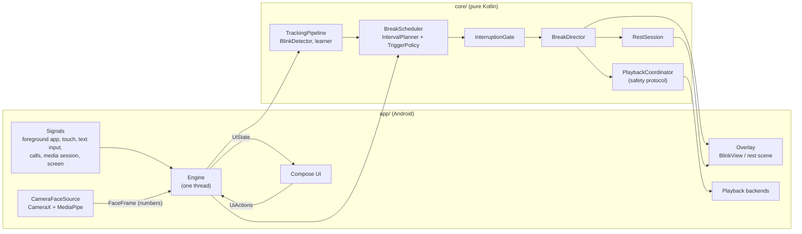

# Architecture

EyeBlink is split so that everything that *decides* something is plain Kotlin that runs on a laptop and is
tested there, and everything that *touches Android* is thin and replaceable.

```
core/            pure Kotlin/JVM - the brain. 450 unit tests, no Android, no Compose.
app/             the Android app: platform layer + the Compose UI.
  ui/            platform-free Compose: design kit, screens, state. Also compiled by the design lab.
  engine/        the one thread that owns scheduling, breaks, tracking, calibration, night mode.
  overlay/       what gets drawn over other apps.
  playback/      the strategies that pause and resume media.
  access/        the accessibility service and the notification listener.
  power/         Shizuku and root.
  camera/        CameraX + MediaPipe, reduced to numbers.
  system/        foreground service, Quick Settings tile, notifications, boot receiver.
  host/          the activity and the glue that hands real implementations to the engine.
lsposed/         optional second APK (Java): hooks a player from inside its app.
xposed-api/      compile-only stubs so the LSPosed module builds without the real framework.
tools/designlab/ desktop renderer: runs the app's real UI headlessly to make screenshots.
jvm-build/       a second Gradle root that builds only the JVM modules (no Android SDK needed).
```



## `:core`

| Package | What lives there |
|---|---|
| `anim` | `BlinkTimeline` (close / hold / open with easing curves), `EyelidGeometry` (the almond lids, shared by the live preview and the overlay), `Easing`. |
| `engine` | `IntervalPlanner` (the adaptive interval and the factors behind it), `TriggerPolicy` (camera-assisted vs camera-free), `InterruptionGate` (touch, typing, calls, transitions, cool-downs), `BreakScheduler` (a pure `step(input) -> step`), `BreakDirector` (runs one break end to end against an `OverlayPort`). |
| `playback` | `PlaybackCoordinator` - the safety protocol - plus `CompatTester` and the per-app, per-version `Compat` policy. |
| `rest` | `RestSession`, the Smart Rest state machine (resting, awaiting confirmation, done; skippable at any moment). |
| `calibration` | `TrackingPipeline` (face frames to blinks, observed rate, learning windows), `EyeGeometry` (eye aspect ratio), `OpenBaseline` (what open looks like for this eye right now), `BlinkDetector` (relative closure, hysteresis), `BlinkThresholds` (fitted to the person), `BlinkStatistics`, `CalibrationSession` (owns detection, eases the deliberate test), `AdaptiveLearner`, `ContextProfile`, `DutyCycle`. |
| `night` | `NightPlanner` - what warmth and brightness to ask for, and when, with ramps and manual-override back-off. |
| `privileged` | `PrivilegedCommands`, `ShellSession`, `MediaSessionDump` (parser for `dumpsys media_session`), `PrivilegedSetup`. |
| `perf`, `stats` | frame-time percentiles, a battery ledger, a content-change detector, daily usage counters. |
| `model` | `EyeBlinkSettings` and its tolerant JSON codec (unknown keys and enum values never throw). |

### The playback safety protocol

`PlaybackCoordinator` never does anything it cannot check afterwards. For every break:

1. **Read** the player. Not playing, or unreadable, or owned by another app: touch nothing.
2. **Pause**, then **verify** by reading the state again within a timeout. If it did not land, the break is reported as
   *unverified* - never as paused.
3. **Remember** what was paused (session, media fingerprint, position, time).
4. After the break, **decide** whether to resume: refused if the user restarted playback, scrubbed, switched video,
   left the app, another app took the session, the pause is too old, or the session ended. Foreground checks outrank state checks.
5. **Resume**, verify, retry once after re-checking the world, and report failure honestly.

The decision table is covered by dedicated tests. The coordinator talks to a `PlaybackBackend` interface, so the same
protocol serves every strategy below it.

## `:app`

### Engine

`Engine` is a single-thread object (a one-thread executor used as a coroutine dispatcher) that owns the master switch,
the scheduler loop, the break director, tracking, calibration, night mode and compatibility tests. Android callbacks
(accessibility events, media sessions, sensors, UI actions) are turned into `Signals` or posted onto that thread, so
there is no shared mutable state to lock. It publishes an immutable `UiState` as a `StateFlow`; the UI sends `UiActions` back.

### What EyeBlink may read

* **Accessibility service** - `canRetrieveWindowContent` is `false`. It reads only the package name, the class name, whether
  the source is a password field, and which of three event *types* happened: a window changed, something scrolled, a field took focus. It is not subscribed to text changes and never reads text.
* **Notification listener** - used for media sessions and to know that a navigation notification is active.
* **Camera** - frames are analysed in memory by MediaPipe and reduced to a `FaceFrame` (eye aspect ratios, the model's blink score, quality, brightness of the face). Pixels never leave `camera/`.

### How a blink is recognised

Eyes differ by a factor of two - a wide eye reads about 0.35 when open, a narrow or heavy-lidded one 0.15 - so nothing in the engine compares an eye with a fixed number.

1. `CameraFaceSource` turns the landmarks of each eye into an **eye aspect ratio**: the mean gap between three upper and three lower lid points, over the width of the eye (corner to corner). It does not depend on how far away the face is, how tall it is, or how the head is rolled. The model's own `eyeBlinkLeft/Right` score rides along as a second opinion.
2. `OpenBaseline` keeps the last eight seconds of each eye's readings and takes a high percentile: **the open level of this eye, now**. Blinks are brief dips below it and barely move it; looking down at a phone or tired lids carry it along within a few seconds.
3. `BlinkDetector` measures each sample as a **closure**: how far below its own open level the eye is (0 = as open as usual, 1 = shut), averaged over the two eyes. A blink starts at `start` and ends below `end` (hysteresis); a closure of a single frame must be deep, one longer than 900 ms is not a blink (and the open level is learned again).
4. `BlinkThresholds` are shares of that closure, fitted per person from the deliberate blinks of the calibration (`start` is half of how deep their full blinks go), and stored with the typical open level so the next session needs no warm-up. The Rhythm page has an *Eye sensitivity* choice (Auto / Higher / Lower) that scales them.
5. `CalibrationSession.process()` owns detection during calibration. In the deliberate step it accepts closures of up to three seconds and shallow ones, listens to the model's blink score as well, and **eases** in three steps (the threshold falls to a fifth of the open level) when the person has tried for eight seconds without a blink counting, while the page says what to try. The thresholds are then fitted to what the person actually did.

`EyeShapesTest` runs this whole path on simulated wide, typical, narrow, monolid, heavy-lidded and asymmetric eyes at 15 and 30 frames per second, with tracker noise, glitch frames, dropped frames and a slow change of gaze.

### Overlay

`OverlayWindows` attaches views as `TYPE_ACCESSIBILITY_OVERLAY` when the accessibility service is connected, otherwise
`TYPE_APPLICATION_OVERLAY`. The blink is a plain `BlinkView` drawing the same geometry as the preview; it takes no touches. The rest scene is a
`ComposeView` hosted for the length of the rest, with its own lifecycle owner, and always uses the Moonlit colours on pure black.
A 1 px `TouchSentinel` window listens for `ACTION_OUTSIDE` so the scheduler can tell that a finger touched the screen.

### Playback strategies

Ranked best to last: LSPosed hook, media session, privileged media session, media key, audio focus, accessibility gesture.
`CompatController` runs the real pause / verify / resume / verify test per app and version on request; `CompatPolicy` (in `:core`) turns the
results into "verified", "failing", "untested" or "retest advised".

A break uses a *proven* strategy when the app has one. When it has none, a break may *try* a strategy that reads the player's own state back
(`Strategy.canTryUnproven`: LSPosed hook, media session, privileged media session): the coordinator pauses only what is positively playing,
checks that the pause landed and resumes only what it paused, so a first attempt cannot do harm, and the outcome (`BreakReport.playbackVerdict()`) is
folded into the app's record - the first successful break verifies the app, three failures in a row switch the strategy off. Strategies that can only
see "is any audio playing" (media key, audio focus, tap) are never tried without a passed test. A break asks the candidates in order (proven ones by rank, then the
ones worth trying, fewest failures first) and moves on to the next when one cannot see the player or cannot deliver its command - that costs the video nothing -
but never after a command has gone out; so a way that is blind on this phone (notification access listed but not working, say) cannot stand in the way of
root reading the very same sessions. Which strategies are *available* is read from the live
state of the permissions and of the privileged shell on every use, never remembered from start-up, because root and Shizuku finish connecting after the app starts.

The coordinator counts the time a look at the player costs (a `dumpsys` through `su` takes a few hundred milliseconds) as waiting time, waits up to 2.5 s for a
pause or a resume to show up, and treats a pause that was only seen after the window, followed by a resume that worked, as a success: a slow phone is not a broken one.
When nothing was paused the break says why - not playing, no media session for the app, player unreadable, command not delivered (for instance because the media keys
currently belong to another app) - and *Diagnostics* shows it, together with a name-free outline of the phone's media-session list in the copied report.

### Power modes

`PowerController` runs a short, fixed list of commands through a `ShellSession` - over Shizuku (reflection on the private
`newProcess`, signature checked against 13.1.5) or `su`. Commands are built by `PrivilegedCommands` with strict quoting
(`ShellQuote`) and parsed by `MediaSessionDump`; both are unit tested. Camera access is never granted this way.

### LSPosed

`:lsposed` is a separate APK with its own manifest. It hooks common player classes and answers EyeBlink over a broadcast
bridge protected by a signature-level permission, replying through a `PendingIntent` so no other app can listen.

### Persistence

One private preferences file holding JSON values written with the settings' tolerant codec. A newer build's file loads in an
older one; a damaged value falls back to its default. There is no network permission to send any of it anywhere.

## The UI

`app/src/main/java/com/eyeblink/app/ui` is **platform-free**: no `android.*`, no `R`. Fonts are injected (`EbFonts`), strings are
`t("English", "Türkçe")` pairs, and the palette is a composition local. That is why the design lab can compile the very same files
for the desktop and render them headlessly with Skia - the screenshots in the README are the real UI, not mock-ups.

* **Kit** (`ui/kit`): `Palette` (Daylight, Moonlit, five `Hue`s), `Type`, `Surfaces` (`raised` + `Card`), `Buttons`, `Controls` (the eye-switch, the eye-slider), `Dock`, `Charts`, `Sheet`, motion helpers.
* **Eye** (`ui/eye`): `EyeArt` draws the mascot; `EyeHero` is the living version with its sky; `EyeMark` is the logo tile.
* **Screens** (`ui/screens`): Home, Blink Studio, Rhythm, Apps, More, Calibration, Night, Power, Diagnostics, Statistics, Privacy, About, Onboarding.
* **Language** is a chip that opens a list (`LanguageSheet`); adding a language is a line in `Language` and a line in the sheet, and every string already takes both.

## Build, test, CI

```
./gradlew -p jvm-build :core:test                  # the brain, anywhere, no Android SDK
./gradlew -p jvm-build :tools:designlab:run --args="build/shots"   # screenshots of the real UI
./gradlew :app:lintDebug :lsposed:lintDebug        # needs the Android SDK
./gradlew :app:assembleDebug :app:assembleRelease :app:bundleRelease
```

GitHub Actions (`.github/workflows/android.yml`) runs on every push: core tests, lint, debug and release builds (per-ABI APKs and an
App Bundle), a guard that fails the build if any APK declares `INTERNET`, the design-lab screenshots, and uploads the artifacts.
