<p align="center">
  
</p>

# How EyeBlink was made

*A making-of: the design, the engineering, the testing and the way of working behind this app. It is written, at the author's request, by the AI that built it (Claude), with the repository open beside me: every number and file name below was read from the code or the git history, and what I could not check is marked as such.*

> **Read this first.** I built EyeBlink in a cloud container. I had no phone, no camera and no eyes to try it on. Everything I know about how it behaves, I know from unit tests, from a desktop renderer that draws the real UI, from an Android emulator in CI, and from what the author pasted back after running my builds on their own phone (crash logs, screenshots, diagnostics reports). So this is an honest account of a project that is *well tested and thinly verified*: the logic holds together, the screens look the way they were drawn, and the real world has so far had its say on exactly one phone. [`README.md`](../README.md#status) keeps the current score card.

**Türkçe özet.** Bu belge EyeBlink'in nasıl yapıldığını anlatır: tasarım (arayüz ve deneyim), mühendislik, test ve çalışma biçimi. Uygulamayı bir bulut kapsayıcısında, elimde telefon olmadan yazdım; yazar, derlemelerimi kendi telefonunda çalıştırıp çökme kayıtlarını, ekran görüntülerini ve tanılama raporlarını geri yapıştırdı. Bu yüzden uygulama *iyi test edilmiş ama az doğrulanmış* durumda: mantık testlerde tutarlı, ekranlar çizildiği gibi, gerçek dünya ise şimdilik yalnızca tek bir telefonda söz aldı. Belgenin başında özet, ardından şartname-kod haritası, zaman çizelgesi, arayüz/deneyim tasarımı, çekirdek mimari, göz kırpma motoru, video duraklatma, test ve sürüm mühendisliği, çalışma süreci ve dürüst eksikler gelir. Metin İngilizcedir (depodaki diğer belgeler gibi).

## Contents

1. [The short version](#1-the-short-version)
2. [The brief, and what I did with it](#2-the-brief-and-what-i-did-with-it)
3. [How the three days went](#3-how-the-three-days-went)
4. [Design: the look, the feel and the way it behaves](#4-design-the-look-the-feel-and-the-way-it-behaves)
5. [The shape of the code](#5-the-shape-of-the-code)
6. [The blink, the schedule and the rest](#6-the-blink-the-schedule-and-the-rest)
7. [Seeing a blink: the camera and the engine](#7-seeing-a-blink-the-camera-and-the-engine)
8. [Pausing a video, safely](#8-pausing-a-video-safely)
9. [Night mode, power modes, the LSPosed module](#9-night-mode-power-modes-the-lsposed-module)
10. [Privacy and safety as design decisions](#10-privacy-and-safety-as-design-decisions)
11. [How it was tested](#11-how-it-was-tested)
12. [Build, signing and release](#12-build-signing-and-release)
13. [Licence and the things that are not mine](#13-licence-and-the-things-that-are-not-mine)
14. [How the work was done: the loop with the author](#14-how-the-work-was-done-the-loop-with-the-author)
15. [What went wrong, and what I learned](#15-what-went-wrong-and-what-i-learned)
16. [What is not done](#16-what-is-not-done)
17. [Appendix: a map of the repository](#17-appendix-a-map-of-the-repository)

---

## 1. The short version

EyeBlink is an Android app for people who spend hours in short-video feeds. Every so often it draws a soft, half-second eyelid over the screen (a *Micro Blink*), now and then it asks for a proper 20-20-20 rest (a *Smart Rest*), and when it can *prove* it paused the video underneath, it gives the video back where it was. It can run on a personal timer, or watch the user's real blinks through the front camera and pace itself by them.

| | |
|---|---|
| **When** | 17-19 October 2026. The first commit is 08:05 on the 17th, the latest is early on the 19th. |
| **Size** | about 90 commits and about 27,000 lines of Kotlin, Java, XML and Gradle: 5,900 in the pure-Kotlin core, 11,900 in the Android app, 8,100 of tests for the core, the rest in the LSPosed module, its API stubs and the design lab. |
| **Tests** | 631 JVM tests in `:core`, plus a walkthrough of the whole app on an Android 15 emulator in CI (debug *and* R8-minified builds). |
| **People** | One author, who wrote the brief, tested every build they could on their own phone (a Xiaomi with root, Android 17) and reported what broke. One builder (me), who wrote the code, the design, the tests, the CI and the docs. |
| **Languages** | English and Turkish, side by side in every string. |
| **Releases** | [0.3.0 and 0.3.1](https://github.com/omersusin/EyeBlink/releases), signed, with checksums. |

Five ideas run through everything, and the rest of this document is mostly these five ideas meeting reality:

1. **Everything that decides is plain Kotlin that runs on a laptop.** The Android layer is thin. That is why a builder with no phone could test the scheduler, the playback safety rules and the blink detector hundreds of times over.
2. **The UI is platform-free too**, so a desktop tool can render the app's *real* screens to pictures. I designed by looking at the real thing, not at an imagination of it.
3. **The eyelid is the only motif.** Switches are eyes, sliders have eyes for thumbs, page changes are blinks, the logo is the mascot. One idea, repeated, is what stops a custom design from looking like a pile of parts.
4. **Never claim what cannot be checked.** A video is paused only after reading that it plays, and called paused only after reading that it stopped. A blink is called *observed* only when the camera saw it. A way of pausing is called *verified* only after a test or a real break proved it on that phone.
5. **The author's phone is the only oracle.** When a build crashed there, the crash log decided the next hour.

---

## 2. The brief, and what I did with it

The author's first message was a long specification in Turkish (about 20,000 characters, with an English version of the requirements), preceded by three instructions that shaped everything after it:

* *"It will not be a Material Design app."* A design of its own, a logo, and a 16:9 banner for the README; the interface and its animations should *impress*.
* *Free hands:* any skill, any data source, any repository; any feature, improvement or optimisation I saw fit.
* *"Add Shizuku and Root modes too."*

The specification itself describes the product from the user's side ("you are watching Reels; a visual break is due; the system pauses playback where it can do so safely; the screen blinks; the video carries on where it was") and then lists sixteen requirements. This is where each of them lives now:

| # | The spec's requirement | Where it is |
|---|---|---|
| 1 | Realistic hybrid blink animation (140 / 150 / 165 ms, pure black on OLED) | `core/anim` (`BlinkTimeline`, `EyelidGeometry`), `app/overlay`, [Blink Studio](#44-blink-studio-the-signature-animation-as-a-control) |
| 2 | Hybrid trigger: camera-assisted or camera-free, never pretending to see a blink it did not | `core/engine/TriggerPolicy`, provenance (`observed` / `estimated`) in the UI |
| 3 | Interactive personal blink calibration, spontaneous and instructed blinks kept apart | `core/calibration/CalibrationSession`, `BlinkStatistics`; the calibration and *Blink test* pages |
| 4 | Continuous personalisation without drifting | `AdaptiveLearner`, `ContextProfile` (video, reading, scrolling, low light) |
| 5 | Smart video pause and resume, layered, verified, never a blind toggle | `core/playback`, `BreakDirector`, `app/playback`, `CompatController` ([section 8](#8-pausing-a-video-safely)) |
| 6 | Adaptive rest completion (a blink, a tap, or time) | `core/rest/RestSession`, `app/ui/rest` |
| 7 | Intelligent interruption scheduling | `BreakScheduler`, `InterruptionGate`, `IntervalPlanner` |
| 8 | Smart night mode | `core/night/NightPlanner`, `app/engine/NightController` |
| 9 | Rootless mode and LSPosed mode | accessibility service + notification listener; the `:lsposed` module |
| 10 | Optional MediaProjection | the change detector is built and tested (`ContentChangeDetector`); the capture is **not wired** |
| 11 | Per-app, per-version compatibility testing | `CompatPolicy`, `CompatTester`, the Apps page |
| 12 | Privacy, safety, reliability | [section 10](#10-privacy-and-safety-as-design-decisions) |
| 13 | Battery and performance | `PerfMonitor`, `DutyCycle`, the battery ledger; measured on the phone, *compared* only when there are hours of data |
| 14 | Configuration interface | the five tabs and eight pages of [section 4](#4-design-the-look-the-feel-and-the-way-it-behaves) |
| 15 | Suggested architecture (ten independent components) | [section 5](#5-the-shape-of-the-code) and `docs/ARCHITECTURE.md` |
| 16 | Implementation roadmap, five milestones | [section 3](#3-how-the-three-days-went) |

The first thing I did with this list was **not to build it, but to check it**. Many of the requirements ask Android for things it does not give an ordinary app: watching another app's touches, pausing "whatever video is playing", running a camera from the background. [`docs/FEASIBILITY.md`](FEASIBILITY.md) is that check, requirement by requirement, with three honest verdicts: **Yes** (a supported API does the job), **With limits** (it works under conditions the app must handle), **Best effort** (it cannot be made reliable, and the app says so instead of pretending). The page changed what I built:

* The camera cannot be started from the background on Android 14+, so the camera runs in short *bursts*, and the app falls back to its timer between them.
* Another app's touches are invisible, so EyeBlink uses a 1-pixel window that receives the *start* of a touch and nothing else, and waits out a debounce.
* "Pause any video" does not exist. It became a layered set of *strategies*, each with a way to confirm itself, and a rule that a strategy that cannot be confirmed is never selected.
* Reading the screen would let the accessibility service read everything, so it was never requested (`canRetrieveWindowContent` is false). An accessibility click on a player's own pause button, which would be the neatest way to pause, is therefore permanently off the table. The cost of that choice shows up in [section 8](#8-pausing-a-video-safely).

---

## 3. How the three days went

The history in `git log` has two halves, because the project was started by an earlier working session and then rebuilt by this one when the author sent the specification above. I describe the earlier half only as far as the commits show it.

| When (UTC unless noted) | What happened |
|---|---|
| **17 Oct, 05:05-08:03** (commits stamped +03:00) | **The first prototype**, about 30 commits: the blink animation, the overlay service, a scheduler, a plain settings UI, an accessibility service, a playback controller, the night display controller, CI with R8 and signing (and the first real CI build, which "surfaced six compile errors"), a calibration core, a MediaPipe eye-openness source, the hybrid trigger policy. 116 tests. |
| **17 Oct, 09:34-11:12** | **The rebuild.** The code is split into a pure-JVM `:core` and an Android `:app`; the privileged shell, the night planner and the ledgers are added; a first design system (*Dusk*, a dark twilight palette), all screens, the rest scene, onboarding and the **headless design lab** appear in one commit; then the Android platform layer, the optional LSPosed module and CI for every branch. |
| **17 Oct, 11:14** | The author's first design feedback: *the colour palette does not look uplifting; I appreciate the effort, but it is very obvious that an AI made it - that is why I told you to load skills.* In the same message: the README and the app's main language must be English, with a chip that opens a list of languages. |
| **17 Oct, 13:45-14:57** | **The redesign** (section 4): *Daylight* and *Moonlit*, five hues, the lip, the mascot eye, the page-blink transition; a new logo, launcher icon, banner and tour GIF; the English README, feasibility and architecture notes. |
| **17 Oct, ~14:40** | The author runs the app: **"The app force stops."** A `termux su` command to read the crash log, a stack trace, and within minutes the cause: the engine's components read saved state before it was loaded (`Fix a crash at start-up`). The same hour, CI learns to **start the app on an emulator** so that it can never again compile fine and die in `Application.onCreate`. |
| **17 Oct, 18:54-20:25** | **The camera chain.** *Calibration → Begin does nothing* on the author's phone. The page now says why the camera could not start; R8 (the shrinker) had stripped what MediaPipe needs (and its logger, Flogger) in the release build, which only a release build shows, so CI gets a second emulator run on an **R8-minified** build; the engine's own tracker was closing the calibration camera under it. |
| **17 Oct, 20:59** | *"The app is very nice, but... my eyes do not open fully, so I cannot pass the deliberate-blink test. Can you improve the engine, for every kind of eye?"* Twenty minutes later: **every eye is judged against its own open level** (section 7). |
| **18 Oct, 00:30-01:34** | A live **Blink test** page; the **licence** ("nobody may take my app and sell it - not even the idea"); **video pausing with root**, which did not pause; an independent review of the pause path. |
| **18 Oct, 05:33-19:14** | **The engine, five times.** Five independent reviews, each followed by a round of fixes; each round: write, mutation-check the tests, hand the code to a fresh reviewer who had not seen my reasoning, fix what was real (section 11). |
| **18 Oct, 12:51 / 18:59** | *"When will it end?"* and *"Work with a todo list. When everything is done, merge your branch into main. Read every message I sent from the start and do what is left. Be effective. Use sub-agents (haiku) so it finishes sooner."* An audit of the app against the specification followed (`Gaps found by auditing the app against its specification`), and `main` got its first merge. |
| **18 Oct, 21:11** | A new crash report from Android 17: *"a camera frame could not be analysed (Can't call getPixel() on a recycled bitmap)"*. Fixed the same evening ([section 7](#the-android-17-bug)). |
| **18 Oct, 23:23 - 19 Oct, 00:00** | **Releases 0.3.0 and 0.3.1**: a release workflow that refuses to publish anything it cannot vouch for, a refreshed banner, screenshots and tour; a new diagnostics report from the author's phone showing 39 blinks and not one attempt to pause a video led to **the discovery that the experimental ways of pausing had no switch in the app** ([section 8](#a-gap-found-late)). |
| **19 Oct** | The banner loses its version number (it would be stale at the next release), and this document. |

The author's messages, in order, are the real project plan. Looking back over them, almost every one of them is a *finding*, not a requirement: something I could not have known without a phone in a hand.

---

## 4. Design: the look, the feel and the way it behaves

### 4.1 The first look failed, and why

The first design system I wrote (commit `fa420a2`, 17 Oct, 10:39) was called **Dusk**, and its own comment reads like a good argument:

> *The app is about light and its absence, so the base is true black (`#000000`, which on OLED means pixels that emit nothing) and every other surface is a barely-there tint of it. Colour is used like the eye uses it: one cool iris (aqua) for things that are awake and alive, one warm seam (amber) for the line where the lids meet. There is deliberately no light theme.*

It had gradients along the lid margins, a "glass" brush of translucent white, glowing accents, a serif/sans pairing. It was coherent, it was derived from the subject, and it was exactly the look that generated apps converge on: a dark, neon, frosted-glass dashboard. Half an hour later the author said so, politely and unmistakably: the palette did not look uplifting, the effort was appreciated, but it was *very obvious an AI had made it*.

The lesson I took was about method, not colour. I had reasoned from a concept ("light and its absence") to a palette. A person making a cheerful product starts somewhere else: with a feeling (toy-like, sunny, tactile) and a handful of rules they never break. So I started again from the author's words, *cheerful, human-made, not Material*, loaded the design guidance available to me (its rules are the ones I quote below: ground the design in the subject, pair typefaces on purpose, choose neutrals deliberately, design both themes, do not template), and wrote down what the new design must **not** do before what it must do.

### 4.2 The rules of the redesign

1. **One motif, the eyelid.** Everything that moves, closes, opens or is round is allowed to be an eye or a lid, and nothing else is a decoration.
2. **Flat colour and tactile depth.** No gradients, no blur, no glow, nothing translucent. Depth comes from a darker *lip* under every raised thing, which sinks when pressed.
3. **Five hues, five roles each**, so a screen is never more than a handful of colours and they always go together: *sun* (yellow), *sky* (blue), *mint*, *coral*, *grape*.
4. **Bright by day, indigo (not black) by night.** Black belongs to the blink; if the app's night theme were black too, the blink would have nothing to be.
5. **Text on a bright fill is always the same navy.** Contrast never depends on which hue a button happens to be.
6. **Motion is lids.** Everything eases the way a lid does, and moving between pages is a blink.
7. **Say what is true, plainly, in two languages.** An interface that makes promises about a medical-looking subject has to be careful with its words.

### 4.3 Colour: Daylight and Moonlit

<p align="center">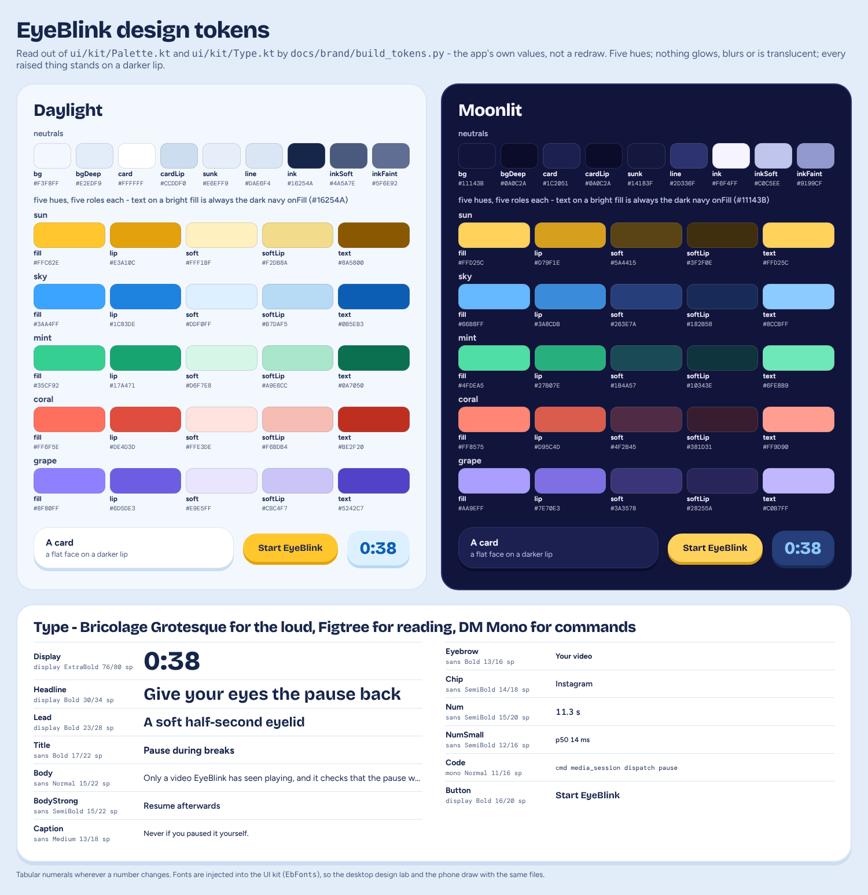</p>

*(That picture is generated from the code: `docs/brand/build_tokens.py` reads `Palette.kt` and `Type.kt`, so it cannot drift from the app.)*

* **Daylight** is a sky-washed white page (`#F3F8FF`), white cards, and ink that is a deep navy (`#16254A`), never black. The neutrals all lean toward the accent's blue: a pure grey on a page full of colour looks unconsidered, a grey with a hue bias looks chosen.
* **Moonlit** is a deep indigo page (`#11143B`), indigo cards (`#1C2051`), the same five hues turned up a step (brighter fills, darker lips and softs) so that they glow *as colour*, not as light.
* Each hue has five roles: `fill` (buttons, marks, big shapes), `lip` (the edge under a raised fill), `soft` (a card's tinted face), `softLip` (the edge under that card) and `text` (the same hue, dark enough to read as small text on a card). A screen assigns a hue to a *part* of itself (the hero is sky, the camera card is mint, a warning card is coral), so colour carries meaning without a legend.
* Status colours are not a sixth family: *ok* is mint, *warn* is sun, *bad* is coral.
* **`OnBlack`**: the rest scene and the blink sit on pure `#000000` whatever the theme, so they use the Moonlit values on black.

### 4.4 Depth: the lip

```kotlin
fun Modifier.raised(shape: Shape, face: Color, lip: Color, depth: Dp = 3.dp, border: Color? = null, sink: () -> Float = { 0f }): Modifier
```

A raised thing is a flat *face* sitting on a darker *lip* a few dp deep. Pressing it moves the face down onto the lip, which stays where it is: **a lid coming down**. There is no ripple anywhere in the app, no elevation shadow and no Material component. Cards (`Card`) have 26 dp corners, buttons are pills, badges are 50 % rounded, the dock is a floating white bar on a lip with a sun-yellow pill that slides to the chosen tab and *stretches a little while it travels*.

This is the part of the design that does the job of shadows and gradients in a default app, and it is also the cheapest thing to render and the easiest to keep consistent: one modifier, used everywhere.

### 4.5 Type

| Face | Used for | Why |
|---|---|---|
| **Bricolage Grotesque** (Bold, ExtraBold) | numerals, titles, buttons, the wordmark | a friendly, slightly quirky grotesque with a lot of personality at large sizes; it is what makes `0:38` look like a toy's display |
| **Figtree** (Regular to Bold) | reading text, captions, chips | round and open, very legible small; it stays out of Bricolage's way |
| **DM Mono** | commands people copy | permission names and shell commands, sized so a 40-character permission name fits a card without wrapping |

All three are under the SIL Open Font License (`app/src/main/assets/FONT_LICENSES.txt`). The scale is thirteen named styles (`Ink.Display` 76/80 sp down to `Ink.Code` 11/16 sp; see the picture above), and everything that changes uses **tabular numerals**, so a countdown does not jitter. The fonts are *injected* into the UI kit (`EbFonts`): Android loads them from `res/font`, the desktop design lab from the same files on disk, so the screenshots use the very same typefaces as the phone.

### 4.6 The mascot, the logo and the icon are one drawing

<p align="center">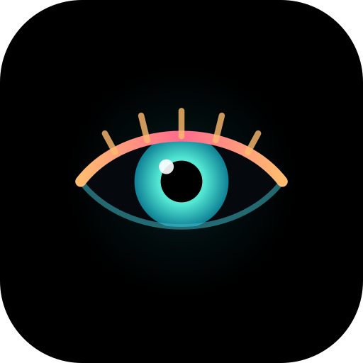</p>

`EyeArt.drawEye` draws a rounded lens, a sun-yellow lid around it, a sky-blue iris with a pupil and a highlight, and five lashes. `docs/brand/build_brand.py` carries the *same geometry* in Python and writes, with no dependencies, the README logo (`logo.svg`), the adaptive launcher icon's foreground, its **monochrome** layer (the themed icon on Android 13+) and the status-bar glyph. The mascot on the home screen (`EyeHero`) is the living version: it breathes, looks around, blinks, and *drains the colour from its iris when EyeBlink is resting*. So the logo, the icon, the hero and the switch you tap are one character, and when it is asleep it looks asleep.

### 4.7 Motion

The motion language is a handful of curves and springs shared by everything (`Motion`), so that the whole UI moves like one object:

* `Motion.Close` (cubic-bezier 0.36, 0, 0.24, 1): *quick and slightly accelerating, like the real thing*; `Motion.Open` (0.16, 0, 0.18, 1): *released fast, settles slowly*. Three springs (`Settle`, `Snappy`, `Soft`) for everything physical.
* **The page transition is a blink.** `BlinkTransition` closes pale sun-yellow lids over the old screen in 150 ms, swaps the content while everything is covered, and opens on the new one in 210 ms. The real blink on the screen is pure black; this one only borrows its rhythm. With reduced motion it is a plain cross-fade through the same colour.
* **Screens arrive in order.** `RevealScope` lifts a screen's parts in one after another from one clock that stops once everything is in place, so a settled screen costs no animation work.
* **Continuous motion reads one clock** (`rememberClockMs`), advanced by the frame clock, so a screenshot at a given millisecond is exactly reproducible: the design lab can ask for the hero eye at 1.8 s and get the same picture every time.

<p align="center"></p>

*(The GIF is the app's own transition, recorded by sending real pointer events to the real UI in the design lab, not an edit.)*

### 4.8 Components: small parts that each carry the idea

<table align="center"><tr>
<td>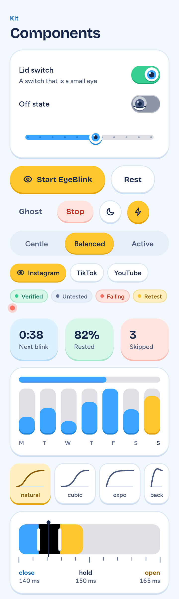</td>
<td>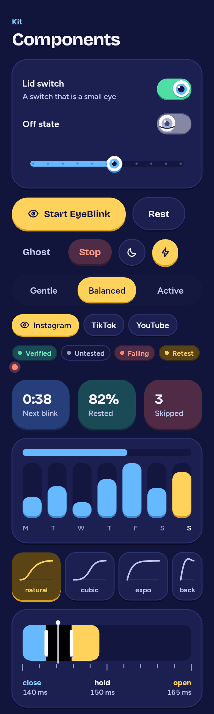</td>
</tr></table>

| Component | The idea |
|---|---|
| `LidSwitch` | **A switch that is a small eye.** Off, a lid hangs over the eye in the knob and it looks sleepy; on, the lid lifts, the iris shows and the groove turns mint. Awake or asleep at a glance. |
| `Horizon` | **A slider whose thumb is an eye**, a tooltip over it while held, detents that tick with a haptic, and exposed to accessibility as a real slider. |
| `Tide` | A segmented selector: a sun-yellow thumb slides to the chosen option (sun-yellow is the colour of "this one" everywhere: the chosen chip, the primary button, today's bar). |
| `PillButton` | Primary (sun, deeper lip), Soft (white or indigo), Danger (pale coral), Ghost. |
| `Dock` | Floating navigation with a pill that stretches while it travels. |
| `Sheet` | A modal sheet rising over a dimmed page; closed sheets are not composed at all. |
| `Badge`, `IconBadge`, `PulseDot` | Status as a coloured dot and a short word; a small raised tile in a hue that heads a row; a dot that breathes for "alive" states like the camera indicator. |
| Charts | Seven bars with today in sun-yellow; easing curves drawn as little selectable graphs; the three beats of a blink as one bar whose seams you drag; fat rounded meters; a 24-hour night dial with a grape arc for the night window. |
| `PhoneFrame`, `AmbientReel` | A phone showing a stand-in feed with the real blink playing over it; and a calm, neutral moving picture for the calibration's "watch" step, video-like but with nothing that could make anyone laugh, flinch or blink on cue. |

### 4.9 Structure: five tabs, eight pages, one switch

<table align="center">
<tr>
<td></td>
<td></td>
<td></td>
<td></td>
<td></td>
</tr>
<tr>
<td align="center"><sub>Today</sub></td><td align="center"><sub>Blink</sub></td><td align="center"><sub>Rhythm</sub></td><td align="center"><sub>Apps</sub></td><td align="center"><sub>More</sub></td>
</tr>
</table>

* **Today** is the app's face: the hero eye with a ring that counts down to the next blink, the three things you actually do (*Blink*, *Rest*, *Snooze*), a card that says what EyeBlink is doing *right now* (which app, which context, camera-assisted or on a timer), the last break, today's numbers, and, only when something is missing, an **Almost there** card that lists what is needed and what is optional.
* **Blink** is Blink Studio: the signature animation as a control (below).
* **Rhythm** is *when*: three presets (Gentle, Balanced, Active), then, behind one switch, every knob.
* **Apps** is *where*: the apps EyeBlink may interrupt, each with its own rules and a plainly worded verdict on whether its video can be paused.
* **More** is the rest, as eight pages: Calibration, Blink test, Night, Power modes, Diagnostics, Statistics, Privacy, About.

**Progressive disclosure.** The spec asked for *simple automatic behaviour or advanced customisation*. The answer is one switch on the Rhythm tab, **Fine-tune everything**: off, the app is three presets and a few switches; on, more controls appear (cool-downs, hourly caps, quiet hours, the fallback for apps that cannot be paused, and since 0.3.1 the experimental ways of pausing). Nothing is hidden for good; things are only out of the way.

**Onboarding** is five steps, and every step can be skipped past: *who EyeBlink is* (with the language chip), *how it behaves*, *which apps*, *what to allow*, *ready*. Only one permission is required (Accessibility, or Display over other apps). Every other permission is explained at the moment it matters, in the words of what it *enables*, not of what Android calls it.

<table align="center"><tr>
<td></td>
<td>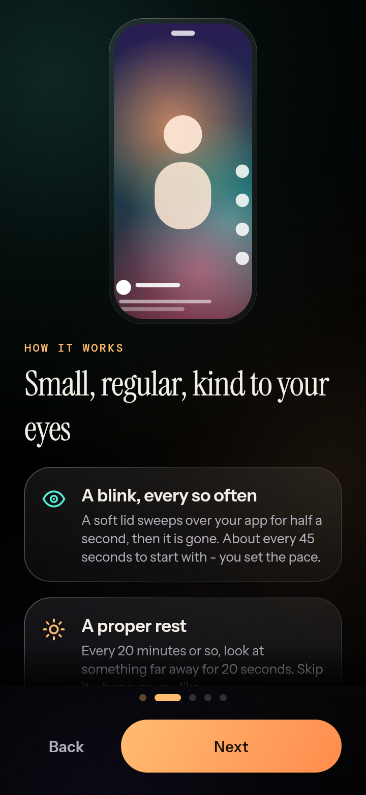</td>
<td></td>
<td>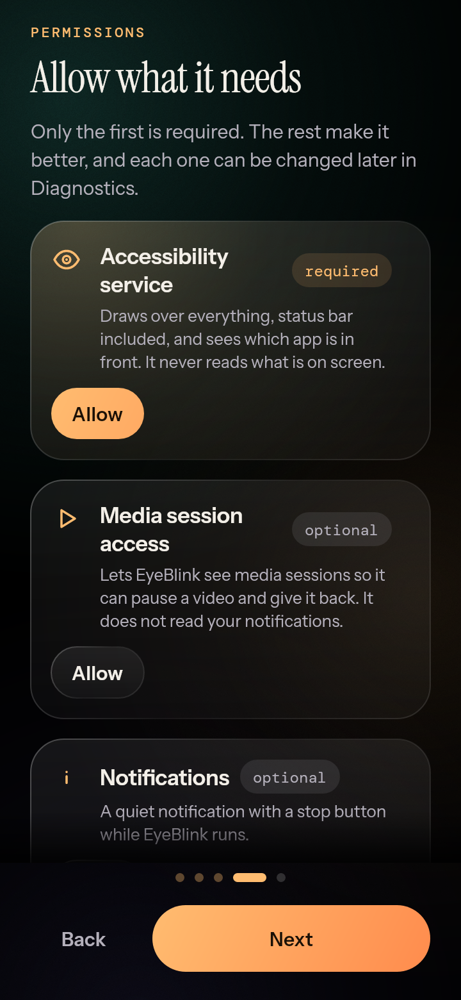</td>
<td>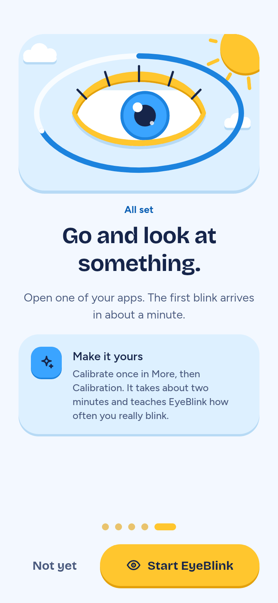</td>
</tr></table>

### 4.10 Honest interface

Because the app makes claims about a body and about another app's video, the interface was designed so that it *cannot* overclaim:

* **Provenance on every number.** A blink rate is *measured* (the camera saw it) or *estimated* (a general profile), and the calibration result page shows which, as blue and grey badges. Without the camera the app says *"EyeBlink is on a timer. It can't tell whether you actually blinked."*; with camera bursts it says the camera *"looks in short bursts. Between them EyeBlink goes by what the last look showed - it can't see your blinks right now."*
* **Verdicts, not features.** An app's card says *will try*, *pause verified*, *can't pause*, *no media session* or *retest advised*, and the sentence under it says what that means and what to do next. Nothing is called supported until a test or a real break has proved it on the phone.
* **Refusals explain themselves.** When a break does not happen, the last-break line on Today says *Skipped:* and the reason; the break's pause and resume results are one tap away.
* **Limits are part of the copy.** Blink Studio says: *"On LCD screens the animation looks the same, but the backlight stays on - EyeBlink never claims otherwise. It is a short visual break, not a replacement for real blinking."* The About page says the app is not a medical device.
* **Errors are cards with a reason**, not toasts: the calibration page can show *Camera access was not allowed* or *The camera could not start* with the sentence the camera layer reported, because that sentence is the bug report. **More → Diagnostics → Copy report** puts versions, permissions and counters on the clipboard (no app names, no content) for exactly that.

### 4.11 Blink Studio: the signature animation as a control

<table align="center"><tr>
<td></td>
<td></td>
<td></td>
</tr></table>

The blink is the product, so its settings are a studio rather than a list. A phone on the page loops a stand-in feed with the *real* blink playing over it (tap it to blink at once), and under it: a **timing bar** with the three beats (close, black, open) each as wide as it lasts, whose seams you drag, with the total updating live; **curves** for closing and opening drawn as little graphs; *Eyelid curve*, *Soft edge* and *Darkening* sliders; four named feels (Natural, Soft, Snappy, Slow drift). The hold is drawn black in the bar because on the screen it is pure `#000000`. **Rim light** exists and is off by default, for a stated reason on the page: lit pixels weaken the OLED effect. **Reduced motion** swaps the sweeping lids for a fade, and is also applied by itself when Android's animations are off.

The **rest scene** (*Smart Rest*) is a Compose view hosted in a touchable overlay for the length of the rest, always in Moonlit colours on pure black: either **Blackout** (the screen stays black) or **Distance Focus** (a calm 20-second countdown that asks you to look at something far away, the 20-20-20 idea). It ends by itself when time is up, or by one tap, or, with the camera on, by one real blink, and it can be skipped at any moment.

### 4.12 Words, and two languages

* **Every string exists in English and Turkish in the same line**: `t("English", "Türkçe")`. The UI has no string resource files, so a string *cannot* exist in one language and be forgotten in the other; the compiler will not let a call omit either. The same text reaches the settings UI, the overlay scenes, the notification and the desktop design lab. There are about 750 such calls.
* The language is a **chip, not a toggle**: it says which language is on and opens a list when tapped, so it keeps working however long the list grows (adding a language is a line in the enum and a line in the sheet).
* English is the default and the README's language, at the author's request; Turkish was proofread in passes (several commits are only that), and Turkish tends to run longer than English, which is why many design-lab pictures exist in a Turkish variant: they are there to catch the string that does not fit.
* Reasons produced far from the screen, in `:core` and the controllers ("Shizuku is not running", "permission not granted", the name of the overlay in use), are plain English there and are translated at the point of display (`Reasons.kt`); one that is not known stays as it was, "which is better than a wrong guess".
* **The voice** is plain, warm and never inflated: *"Videos wait for you - only when it can prove it paused."* It speaks of what *EyeBlink* does and cannot do, never of what the user should feel.

### 4.13 Accessibility and motion safety

* **Reduced motion** is a first-class mode (`LocalReducedMotion`): the system's animator scale at zero, or the user's choice in Blink Studio, turns every sweep into a fade, including the page transition.
* Controls are real controls to TalkBack: the eye-slider is exposed as a slider, switches and buttons carry roles and descriptions (about seventy places in the UI set semantics).
* Contrast does not depend on hue: text on a bright fill is always the same navy; small coloured text uses each hue's darkened `text` role.
* The UI pads by the system's insets (`LocalInsets`) while the backdrop runs edge to edge.
* The blink is a 455 ms close-hold-open, and it cannot repeat faster than the cool-down (10 s by default, with an hourly cap of 90).

### 4.14 Designing without a phone: the design lab

This is the single most useful thing I built for myself. `tools/designlab` is a small desktop program that compiles the app's *own* UI files and renders them to PNG with Skia, with no Android in sight. It works because `app/.../ui` is **platform-free**: no `android.*`, no `R`; fonts are injected, strings are plain pairs, the palette is a composition local. A run draws **68 pictures**: every screen in both themes, the Turkish variants, the calibration in each of its states (including the error and the denied-permission cards), the rest scenes, the component gallery, and the tall settings pages that scroll.

The loop it made possible was: change a composable → render → *look at the picture* → change it again, over and over; it is how the design was iterated at all, with no human between the code and the look. It caught layout problems before they reached the author: text that did not fit, words that ran outside the banner's stamp, a number that wrapped in a narrow tile (I fixed one of those in the component gallery while writing this document).

The same program is a CI step (the pictures are uploaded as the `eyeblink-ui` artifact on every run), and it feeds the README:

* `refresh_docs.py screens` quantises the pictures into `docs/screens` (256-colour PNGs: flat colour compresses to a third of the size and looks identical),
* the **tour GIF** is recorded by sending real pointer events to the real UI and writing every frame of the page transitions,
* the **banner** is an HTML page (`banner.html`) that uses the app's own fonts and two of its own screenshots as phones, rendered by Chromium (`render.mjs`),
* the **logo and icons** come from one script, and the **tokens picture** above from another.

What the design lab cannot tell me is what the author's thumb tells them: whether a target is comfortable, how the fonts render on an actual panel, whether the animations feel right at 120 Hz. Those are the open questions of the design, and I list them in [section 16](#16-what-is-not-done).

### 4.15 Things I would still change

* The **tall pages** (Rhythm with *Fine-tune everything* on, Power modes, Diagnostics) are long scrolls of cards. They are well-ordered but they are not *designed* the way Today and Blink Studio are; they are where the app is most like a settings app.
* The new **experimental pause switches** live three levels deep. They had to be reachable first; making them *discoverable* (for example from the card of an app that shows no media session, which now at least says where they are) is a better flow than a hint.
* Some screens are **dense in words**. The explanations are honest, but a person in a hurry will not read them; a few of them want an illustration instead of a paragraph.

---

## 5. The shape of the code

[`ARCHITECTURE.md`](ARCHITECTURE.md) is the reference, with a table of every package. This section is the *why*.

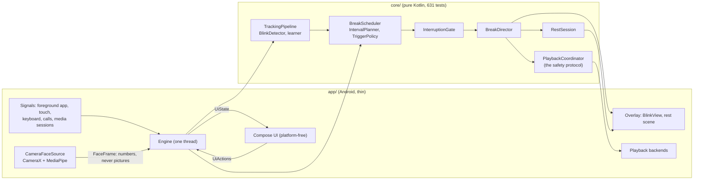

**Everything that decides is plain Kotlin that runs on a laptop** (`:core`: no `android.*`, no Compose). The scheduler is a pure function, `step(input) -> step`; the break director runs one break end to end against an `OverlayPort`; the playback coordinator talks to a `PlaybackBackend` interface; the privileged layer talks to a `ShellExecutor`. The Android layer implements those ports and nothing else. That is not tidiness for its own sake: it is the reason a builder who could never run the app could still test the part that matters most hundreds of times a minute, with fake players, fake shells, fake clocks and simulated eyes.

**The UI is platform-free too** (section 4.14), and it is compiled by two builds: the Android app and the desktop design lab.

**One thread owns the engine.** `Engine` is a single-thread coroutine dispatcher that owns the master switch, the scheduler loop, the break director, tracking, calibration, night mode and the compatibility tests. Android callbacks (accessibility events, media sessions, sensors, UI actions) are turned into plain `Signals` fields or posted onto that thread, so there is no shared mutable state to lock. It publishes an immutable `UiState` as a flow; the UI sends `UiActions` back. When something went wrong, one thread meant I could always say *what ran first*.

**State is tolerant.** One private preferences file holds JSON written with a tolerant codec: a newer build's file loads in an older one, an unknown key or enum value never throws, and a damaged value falls back to its default instead of crashing the service at boot. Every setting has a `validated()` that clamps hand-edited or stale values into a range the code can still render sensibly. (The launch crash of day one was a start-up *ordering* bug, not a data bug, but this is the same lesson from the other side.)

### I could not compile the Android layer

The container I worked in could reach Maven Central but **not Google's Maven repository**, so the Android Gradle Plugin, the Android SDK and every `androidx` library were out of reach. The repository therefore has two Gradle roots built from the same sources:

```
./gradlew -p jvm-build :core:test                       # the brain, anywhere, no Android SDK
./gradlew -p jvm-build :tools:designlab:run --args=...  # the UI, rendered on the desktop
./gradlew :app:lintDebug :app:assembleRelease ...       # the real app: Android SDK needed (CI)
```

`jvm-build/` includes `:core`, `:xposed-api` and the design lab from `../`, with only Maven Central repositories. Everything in `:app` that is not the platform-free UI (the services, the overlay, the camera, the playback backends, the Shizuku and root bridges, the host activity, the LSPosed module) was compiled **only by GitHub Actions**, about twelve minutes after I pushed it. So CI was my compiler, my linter, and, with its emulator job, my device. It changed how I wrote: Android code was kept thin and boring, every non-trivial decision was moved down into `:core` where I could test it, and I re-read my own diffs adversarially before pushing because a typo cost a twelve-minute round trip. The first real CI build of the prototype "surfaced six compile errors", and there were more such moments after it (`getLensFacing()` is experimental; `-neverinline` is not available to R8 in a build).

---

## 6. The blink, the schedule and the rest

### The animation

`BlinkSpec` is the whole description of one blink: **140 ms closing, 150 ms of pure black, 165 ms opening, 455 ms in total** (the spec's numbers), two easing curves, how strongly the lid margins bow into an almond, how soft the margin is, how strongly the screen dims while the lids close, an optional rim light (off: lit pixels defeat OLED black), and a reduced-motion flag. `BlinkTimeline` maps elapsed time to a `BlinkFrame` (a phase, a closure from 0 to 1, a dim level, and the alpha of the pure `#000000` cover); **nothing in it reads a clock**, the caller feeds it milliseconds, so the animation is deterministic and testable.

`EyelidGeometry` turns a closure into the lid margins, as quadratic curves through `(0, edge)`, `(w/2, mid)`, `(w, edge)` with a few translucent feather layers painted outermost first so that their alphas stack into a soft edge. It is shared by the system overlay, the live preview in Blink Studio and the hero animation, and its invariants are pinned by tests: at closure 0 nothing is drawn; at closure 1 the solid margin sits exactly on the centre line with no bulge and no feather, *so the two lids meet with no light between them*; the margin only ever moves toward the centre as closure grows.

### The overlay

The blink is drawn by `OverlayWindows` as a `TYPE_ACCESSIBILITY_OVERLAY` when the accessibility service is connected (it needs no extra permission and can cover the status bar), otherwise as a `TYPE_APPLICATION_OVERLAY` ("Display over other apps"). It is a plain `BlinkView` with `FLAG_NOT_TOUCHABLE`, so it takes no touches and Android 12's untrusted-touch rules do not apply to it. The windows **re-fit themselves when the screen rotates**. If the service dies, whatever it drew disappears. A 1-pixel `TouchSentinel` window listens for `ACTION_OUTSIDE`: it is how the scheduler learns that a finger touched the screen *somewhere*, without coordinates and without the finger's lift.

### The schedule

`BreakScheduler.step(input)` returns one of `Idle`, `Waiting`, `Deferred` or `Start`. Three pieces feed it:

* **`IntervalPlanner`** turns the chosen interval into the interval *now*, as a list of named multipliers so the UI can say why the next blink is when it is: the app's own scale, the personal baseline (trusted fully when it was observed, half when it is an estimate), a reading or low-light prior, a long-session factor that shortens the interval smoothly from 10 to 45 minutes down to 70 %, the observed blink rate (a person who blinks less than the average gets *shorter* gaps, within a bounded range), a back-off after skipped breaks, and a few per cent of jitter. Three presets: **Gentle** (90 s / 30 min), **Balanced** (45 s / 20 min), **Active** (25 s / 15 min). The README says plainly that this is a product heuristic, not medicine.
* **`TriggerPolicy`** decides camera-assisted or camera-free for this moment, and carries the rule that EyeBlink *never claims to have seen a blink it did not*.
* **`InterruptionGate`** answers "may I interrupt now?" with a reason, and the reasons come in three kinds: *ineligible* (screen off, locked, an app that is not on the list, quiet hours, battery saver, thermal limits), *hold* (a call, the camera in use elsewhere, navigation, a sensitive screen, a text field, the cool-down, a finger on the screen, which is never overridden), and *soft* (a recent touch, a video transition, waiting for a swipe), which a deferral budget (45 s by default) may override. A `NeverInterrupt` list keeps EyeBlink off calls, emergency, the lock screen, biometric prompts, settings, camera capture, wallet and the credential and payment apps, even when the user selected them.

Smart Rest is a small state machine (`RestSession`: resting, awaiting confirmation, done, skippable at any moment) with two styles and three ways to end (section 4.11). The **break director** runs one break from start to finish in a fixed order, *re-check → pause and verify → draw → re-check the world → resume and verify → clean up*, and its clean-up runs in a `NonCancellable` block: whatever happens in the middle (an exception, the emergency stop, the job being cancelled), the overlay is removed and a video EyeBlink paused is handed back.

---

## 7. Seeing a blink: the camera and the engine

This is the part of the project where the author's own body changed the design.

### What the camera does, and when

The camera path uses the front camera with **CameraX** and **MediaPipe Face Landmarker**, and it reduces each picture to a few numbers in memory: how open each eye is, the model's own blink score, a quality score and the brightness of the face. The pixels never leave `camera/`. A blink lasts 100-150 ms, so useful detection needs about 15+ pictures a second and good light; since Android 14 a camera foreground service cannot be *started* from the background, so in the default **Bursts** mode the camera looks for a few seconds every so often and the app goes by what the last look showed in between; **Always** keeps it on while a chosen app is in front; **Off** is the timer. A visible indicator shows whenever the camera is on, and the Quick Settings tile suspends everything, camera included, from anywhere.

### The first engine, and the author's eyes

The first detector compared an eye-openness number with a fixed threshold. It passed every test I wrote, because I had written the eyes. Then the author tried the calibration's *blink on purpose* step and could not pass it, and said why: **their eyes do not open fully**. They went on to name the larger point: people of different ethnicities, narrow eyes, monolids, heavy lids: *improve the general engine*. A fixed threshold quietly encodes one kind of eye. A wide eye reads about 0.35 when open, a narrow or heavy-lidded one about 0.15; nothing in the engine may compare an eye with a fixed number.

So the engine now measures **every eye against its own open level**:

1. The model's landmarks become an **eye aspect ratio** (mean lid gap over eye width, corner to corner), which does not depend on distance, face height or head roll; the model's own blink score rides along as a second opinion.
2. `OpenBaseline` keeps the last eight seconds of each eye's readings and takes a high percentile: *the open level of this eye, now*. Blinks are brief dips below it and barely move it; a lowered gaze or tired lids carry it along within seconds.
3. `BlinkDetector` measures every sample as a **closure**: how far below its own open level the eye is (0 = as open as usual, 1 = shut), averaged over the two eyes, with hysteresis (a blink starts past one level and ends below a lower one).
4. `BlinkThresholds` are *shares of that closure*, fitted per person from their deliberate blinks, and stored with the typical open level so the next session needs no warm-up. The Rhythm page has an **Eye sensitivity** choice (Auto, Higher, Lower) for the rest.
5. The deliberate step **eases** by itself if eight seconds pass without a blink counting (the bar falls in three steps, to about a fifth of the open level), while the page says what to try (*"Close your eyes a little more firmly. It only has to look clearly different from your open eyes."*); and a person who *holds* their eyes shut, which never counts, is asked to open them between blinks.

<table align="center"><tr>
<td></td>
<td>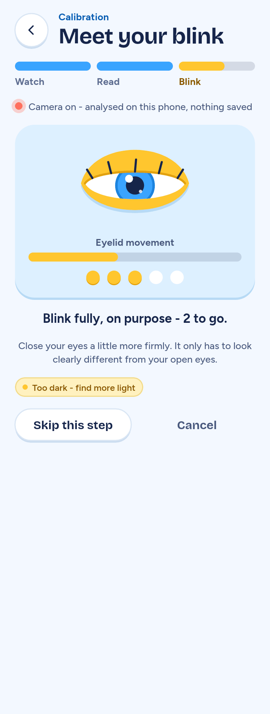</td>
<td>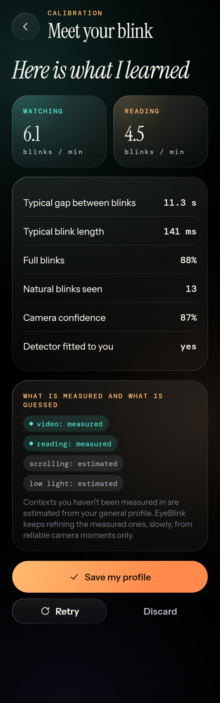</td>
<td>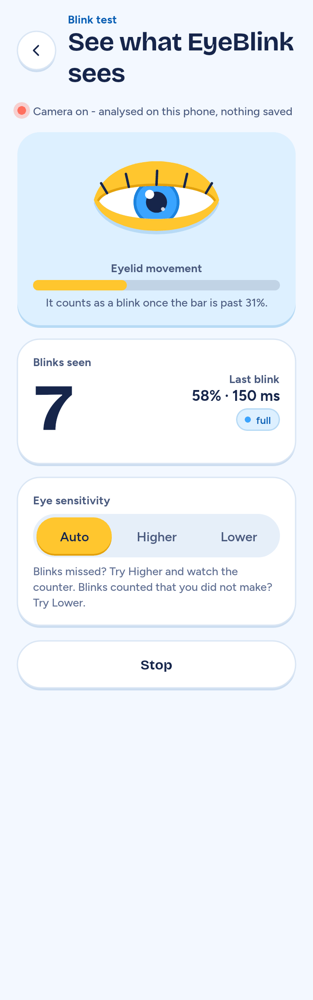</td>
</tr></table>

The **calibration** is three steps, each with a slider for how long it takes: *Watch* (a calm moving picture while the app notes your natural blinks), *Read* (a short passage, because reading changes how often you blink), *Blink on purpose* (a few deliberate full blinks, so the app learns what a closed eye looks like on *you*). Spontaneous and deliberate blinks go into separate buckets. The result page shows what it learned and labels each number *measured* or *estimated*. The **Blink test** page is the same engine, live: an eye that moves as yours does, a counter, and a meter with a line that shows where a movement starts to count.

### What is hard about it, in the order I found out

Each of these was a bug in a version I had believed in, found by an independent reviewer or a simulation, and each has a test that pins it (the rules are listed one by one in `ARCHITECTURE.md`; here is the shape):

* **Shut eyes are not blinks.** A rest, or a person who closes their eyes harder because nothing counts, must not produce phantom blinks while the eyes are shut or when they open. A closure is judged against the open level of the moment it *began*, and nothing is learned while the eyes are shut.
* **Nothing may depend on what a shut eye reads.** The lids of some eyes move by a quarter and no more, and nobody knows what the face model's score is for such an eye, or for a gaze lowered at a phone. So the score is never asked to reach a number. What says "shut" is the *median of the lids over the last 1.2 s*: a window, not a frame, so that a blink inside a lowered gaze, and jitter in lids that are only just down, cannot flip the answer.
* **A lowered gaze is not a rest.** Looking down at a phone lowers the lids as much as a squint. A long closure that is not shut is taken to be the new open level and learned again, and if the lids settle between "ended" and "started" for a quarter of a second, the blink ends there. This is what keeps blinks countable *while the gaze is on the phone*, which is when the app is used.
* **A blink has to stand out of the jitter.** How far a tracker's readings jump from one frame to the next is learned along the way, and a closure of the *lids* has to start well past that (four times the average of the two eyes' jitter). The eyes' jitter is averaged and not combined as if independent: how much they share depends on the tracker, and a gate that took them for independent let a noisy tracker report a blink every few seconds for eyes that did not blink at all.
* **Quick deliberate blinks must count.** A deliberate blink has to be past the threshold in two pictures at least (a blink is closed, held a moment and opened, so even the quickest shows in two of the thirty pictures a second), or go deep in one; a minimum length in milliseconds would do the same for a noisy tracker but would turn away people who blink on purpose as quickly as they blink by themselves.
* **Gaps.** A run of bad pictures or a face that goes away ends a blink in progress, but not eyes that were shut tight, which are most likely still shut when the face comes back.
* **Burst mode forgets.** When the camera sleeps between bursts, the readings run out; the last level they made stands in for them, and a rest that begins while the camera is off is still a rest when the next burst finds it.

I tested all of this on **simulated eyes** (`EyeShapesTest`: wide, typical, narrow, monolid, heavy-lidded, asymmetric and barely-moving eyes, at 15 and 30 pictures a second, with tracker noise, glitch frames, dropped frames and a slow change of gaze), in fuzz tests, and by running old and new detector versions through the same simulated recordings side by side. All of it is simulation. **The numbers say that the logic holds together, not how MediaPipe behaves on any particular face**, and the engine has not yet been shown to a real narrow eye. One limit is documented rather than solved: eyes whose lids close by less than about half even when shut as far as they go cannot be told from a lowered gaze by the lids alone, so their rests count as staring.

### The Android 17 bug

On 18 October the author pasted: *"The camera could not start - a camera frame could not be analysed (java.lang.IllegalStateException: Can't call getPixel() on a recycled bitmap)"*, with a diagnostics report from Android 17. The cause was mine: MediaPipe's `MPImage`, when closed, recycles the `Bitmap` it was built from; I closed it and then read the face's brightness from the same bitmap. The model now gets its own copy, and one bad picture no longer stops the camera: five in a row do, and then the reason is shown. The error screen's last line, *"If this keeps happening, copy the report from More → Diagnostics and send it"*, exists because of the first crash on day one.

---

## 8. Pausing a video, safely

The spec called this *a major feature*, and it is the one that most depends on things I do not control.

### The protocol

`PlaybackCoordinator` never does anything it cannot check afterwards:

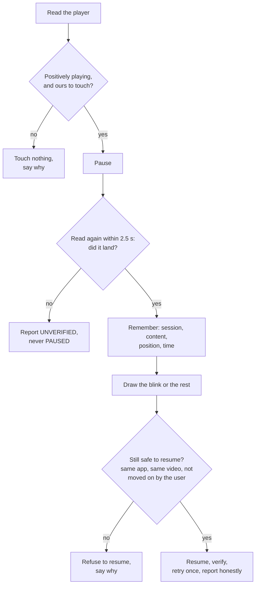

The decision to resume is refused if the user restarted playback, scrubbed, switched video, left the app, another app took the session, the pause is too old, or the session ended; foreground checks outrank state checks. The decision table is covered by dedicated tests, and the same protocol serves every strategy under it.

### Strategies, best to last

| Strategy | Reads the player? | Notes |
|---|---|---|
| LSPosed hook | yes | in-process, most precise, most fragile; needs a passed test |
| Media session | yes | through the notification listener's access to `MediaSessionManager`; `pause()` / `play()` verified by reading `PlaybackState` |
| Privileged media session | yes | the same, through Shizuku or root (`dumpsys media_session`, `cmd media_session dispatch`) |
| Media key | no, only "is audio playing" | goes to whichever session holds the media button |
| Audio focus | no, only "is audio playing" | asks other apps to yield; many pause, many only duck |
| Accessibility tap gesture | no, only "is audio playing" | one tap in the middle of the screen; a toggle |

A strategy that cannot confirm anything is never selected. The ones that read the player's own state may be *tried* by a real break on an app where nothing is proven yet (the break's own check is the proof: the first successful break verifies the app, three failures in a row switch the strategy off); the ones that cannot read it need a passed deliberate test first. Results are kept per app and per app version. A break asks its candidates in order, moves to the next only when one cannot see the player or cannot deliver its command (that costs the video nothing), and never after a command has gone out.

### Reading what the phone says: `dumpsys media_session`

Root and Shizuku let EyeBlink see *every* media session. The output of `dumpsys media_session` is not an API and drifts between Android versions, so `MediaSessionDump` is a tolerant parser: it anchors on each record's `package=` line, accepts `state=3` or `state=PLAYING(3)`, returns whatever it could read, and treats anything missing as *unknown*, which nothing above it acts on. It was first tested against dumps **modelled on the AOSP source** for Android 14 and 15. The first dump from a *real* phone arrived inside a diagnostics report from Android 17: a phone-call session before the user's own record, three players, and, interesting for safety, a media button held by an app that was *stopped*, while the paused one was another. That dump is now a fixture, and the rule it exercises is the reason a key is never sent: **media keys go to whichever session holds the button, not to a named app, so a key is sent only when the dump says the target's session is that session.** The report format itself was designed so such a dump can be sent without sending anything personal: package names become placeholders, titles and artists are dropped, and the sessions of the apps the user chose are marked.

### The story of "the video does not pause, even with root"

The author's message was five words long, and it took four rounds:

1. *Root was not being used at all.* A strategy needed a hand-run compatibility test before any break could use it, and the test could not pass until the app was in front with a video playing. The first fix was the rule above: a strategy that reads the player back may be tried by a real break with no test, because the break's own verification is the proof.
2. *The app forgot that root was ready*, because the list of available strategies was taken once at start-up and root finishes connecting a moment after the app starts. It is now read live on every use.
3. *A slow phone was mistaken for a broken one.* A `dumpsys` through `su` takes a few hundred milliseconds. The coordinator now counts the time a look costs as waiting time, waits up to 2.5 s for a pause to show up, and treats a pause seen only after the window, followed by a resume that worked, as a success.
4. *A strategy that cannot see the player was standing in the way of one that can.* Notification access can be listed as available and still show nothing, while root reads the very same sessions. A break now moves on to the next candidate when one cannot see the player.

### A gap found late

After 0.3.0 the author pasted a diagnostics report: 39 micro blinks in a week, `pauses: verified=0 unverified=0 failed=0`, nothing else to read. Those three counters count only breaks where a command went out, so a week of zeros could mean *never playing*, *never visible* or *never asked*. The report could not tell me, which was a design flaw in the report. It now says how the week's breaks met the player (paused, not playing, no session, unreadable, no way left to try), what is decided and remembered for each chosen app, and which sessions in the outline are those apps'. A new version of EyeBlink also forgives, once, what an older build gave up on (a failed hand-run test used to switch a way off for good).

Reading the code while chasing that report, I found the real hole. The apps the spec names, TikTok, Instagram Reels and YouTube Shorts, mostly publish **no media session at all**, so every strategy that reads a player has nothing to read, with root or without. Three other ways exist (audio focus, a media key, a tap gesture), and they were implemented, tested and **switched off by a setting that nothing in the app could change**: `allowAudioFocus`, `allowMediaKeys` and `allowGestureTap` defaulted to false and no screen exposed them, so for the author's main use case no pausing could ever happen. Version 0.3.1 gives them switches (Rhythm → Fine-tune everything → Your video → Other ways to pause), and the card of an app with no media session now says where they are. They are experimental, said so on the page, and *none of them has been run on a phone*: they see only whether sound stops, so a muted video or another app's music can fool them.

How did two audits against the specification and five reviews miss it? Each looked for things *wrong* in what existed; none asked whether a feature that existed could be *reached*. It is the kind of gap only a user's report, or a test written from the user's side, finds.

---

## 9. Night mode, power modes, the LSPosed module

**Night mode** (`NightPlanner` decides, `NightController` acts): warmth through Night Light and brightness, driven by the clock and the room's light (below 3 lux counts as night whatever the clock says), with eased ramps. Brightness needs `WRITE_SETTINGS`, which the user can grant; Night Light needs `WRITE_SECURE_SETTINGS`, which only adb, Shizuku or root can grant, and its implementation differs between manufacturers. Its rules are the polite ones: everything comes from the user's own settings, there is a hard brightness floor, `manageNightLight` and `manageBrightness` are independent opt-ins, a manual change by the user pauses the automation for a while, and what EyeBlink changed is **put back** when it stops, including after an emergency stop or a restart (the restore state is persisted).

**Power modes** are three operating modes (`ROOTLESS`, `SHIZUKU`, `ROOT`) negotiated at runtime. `PowerController` runs a short, fixed list of commands through a `ShellSession`: over Shizuku (reflection on its private `newProcess`, with the signature checked against the version the code was written for) or over `su`. Commands are built by `PrivilegedCommands` with strict quoting (`ShellQuote`) and parsed by `MediaSessionDump`; both are unit tested, and a dedicated suite tries to inject a command and fails. Camera access is never granted this way. The point of the modes is one-tap setup and a more reliable view of media sessions, not more power: rootless is the baseline and everything else is optional.

**The LSPosed module** is a separate, tiny APK written in plain Java on purpose (it runs inside *other apps'* processes, where a Kotlin runtime would be one more thing that could clash), against compile-only stubs of the Xposed API (`:xposed-api`). It hooks the *construction* of players (`MediaPlayer` and the ExoPlayer implementations) and nothing else: "nothing about how the app plays, loads or shows content is changed, and the players are only ever touched when EyeBlink asks". It answers over a broadcast bridge protected by a **signature-level permission**, replying through a `PendingIntent`, so no other app can listen; the module and the app must therefore be signed with the same key. It is the most fragile strategy, and only used for an app after its own test passes.

---

## 10. Privacy and safety as design decisions

* **No network.** The app does not hold the `INTERNET` permission: it is *removed in the manifest* (`tools:node="remove"`, so even a library that asks for it cannot get it), and CI fails the build if any APK, the release ones and the module's included, declares it. There is no account, analytics, advertisement or server. (An audit found that the check used to run *before* the release APKs existed, so it only ever looked at the debug ones; it now runs after.)
* **No screen reading.** The accessibility service does not request window content. It sees which app is in front, whether a field is a password field, and three event *types* (a window changed, something scrolled, a field took focus), never text.
* **The camera is analysed in memory.** Pixels become a few numbers and are discarded, never stored or sent; a visible indicator shows whenever the camera is on.
* **Everything is local and deletable.** Settings, calibration numbers, daily counters and per-app test results live in one private file; each can be cleared on the Privacy page.
* **Fails closed.** If the service dies, whatever it drew disappears. It does not draw over calls, the lock screen, password fields, system settings, or the wallet and dialer apps, and it says plainly that it does not recognise a payment or sign-in screen *inside an ordinary app*.
* **Never resume what the user paused**, never touch a video it cannot read, never send a blind toggle; the emergency stop is one tap in the app or on the Quick Settings tile.
* **Honest about limits** is itself a safety feature: not a medical device, no claim to treat dry eye, the LCD backlight stays on during the black hold and the app says so.

---

## 11. How it was tested

| Layer | How | What it proves |
|---|---|---|
| `:core` | **631 JVM tests**: calibration 266, engine 105, privileged 74, playback 70, animation 35, perf 21, rest 17, model 15, night 13, stats 10, licence files 5 | the decisions: scheduling, gating, the playback safety protocol, the dump parser, the blink engine on simulated eyes |
| Blink engine | `EyeShapesTest` (seven eye shapes, two frame rates, noise, glitches, dropped frames, gaze changes), fuzz tests, old-vs-new comparisons on the same simulated recordings | that the logic holds together; **not** how real faces behave |
| Tests of the tests | **mutation checks**: a script breaks the code on purpose (one change at a time) and expects a test to fail; survivors became new tests | that the tests notice the bugs they are there for |
| Independent review | the engine and the pause path were handed to fresh reviewers in separate git worktrees who saw the code but not my reasoning; five rounds for the engine, plus a statistical review | the bugs I could not see because I wrote them |
| Audits | read-only sweeps of the app against the specification and the docs | gaps, and docs that claimed more than the code did |
| UI | the design lab renders every screen in both themes on every CI run | that the screens look as designed |
| Android layer | CI: lint, debug and release builds, a guard that fails if any APK asks for the network, signature verification, and an **emulator walkthrough** of debug and R8-minified builds (onboarding, a rest and skipping it, a blink, every tab and page, Blink Studio, the app picker, the calibration camera allowed and refused, the language list and theme, then the engine running with accessibility on) | that the app starts, survives its own UI and does not die in R8 |
| The real world | the author's phone | everything else |

## 12. Build, signing and release

* Two Gradle roots (section 5); AGP 8.7.3, Kotlin 2.0.21, JDK 17, `minSdk 26`, `targetSdk 35`.
* Release builds are R8-minified with resource shrinking, split per ABI (`arm64-v8a`, `armeabi-v7a`, `x86_64`; MediaPipe's native library made a universal APK 50 MB), and signed v2/v3/v4 from repository secrets that never touch the repository.
* **Android CI** runs on every push (docs-only pushes skip it): core tests, lint, builds, the network guard, the design lab, signature verification, the emulator walkthroughs, and small per-phone downloads.
* **Release** (`.github/workflows/release.yml`) runs on a `vX.Y.Z` tag or by hand, and refuses to publish unless the tag matches the version in the app and the module, the commit is on `main` and has a green CI run, the notes exist and the signing key is present. It verifies every APK (signature, one signer for all, version, no `INTERNET`), attaches the APKs, the module, the R8 mapping and `SHA256SUMS.txt`, and never moves a tag or overwrites a release. I tested its shell against a fake repository and fake tools in every refusal case before it ever ran.

## 13. Licence and the things that are not mine

EyeBlink is under the **PolyForm Noncommercial License 1.0.0**, because the author asked that nobody take the app and sell it. It is source-available, not OSI open source, and a licence covers code, design and text, not an idea. MediaPipe and its model (Apache 2.0), the Shizuku API (MIT), AndroidX and Kotlin (Apache 2.0) and the three typefaces (SIL OFL 1.1) stay under their own licences; their texts ship in `licenses/` and in the app.

## 14. How the work was done: the loop with the author

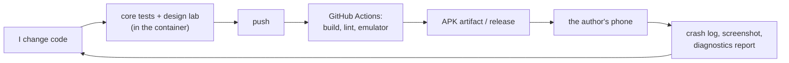

* **Roles.** The author owned the brief, the taste and the only phone; I owned everything in the repository.
* **Latency.** One loop through the phone took from minutes to hours; one loop through CI about twelve minutes; one loop through the core tests or the design lab under a minute. So I pushed as much as possible into the fast loops.
* **Helpers.** Sub-agents did read-only inventories and audits; fresh reviewers in separate worktrees did the reviews; their reports were treated as claims and checked in the code before anything was changed.
* **Discipline that grew out of mistakes**: a todo list for every request, re-reading the author's messages from the start before declaring anything done, and never reporting a fix as working when it had only compiled.

## 15. What went wrong, and what I learned

* **The first design looked generated.** I reasoned from a concept instead of from a feeling. Lesson: write down what the design must *not* do, and look at it.
* **A crash at start-up shipped** because CI compiled the app and never started it. Lesson: start it in CI, debug *and* minified.
* **R8 broke the camera only in release builds.** Lesson: test the build people install.
* **My first blink detector encoded one kind of eye.** Lesson: tests written from my own assumptions cannot find my assumptions; the author's eyes did.
* **Some fixes made new bugs** (a noise gate too loose, a minimum length that turned away quick blinks). Reviews and mutation checks caught them; one reviewer's fix needed another review.
* **Docs claimed more than the code did** in a few places; audits found them.
* **A feature existed and could not be reached** (section 8). Lesson: audit from the user's side, not only the code's.
* **Use-after-recycle on Android 17**: an API's ownership rule I did not read closely enough.

## 16. What is not done

* Nothing in the blink engine has been checked against real faces; the narrow-eye promise is a tested hypothesis.
* The experimental pausing ways, Shizuku, root on output other than the author's, and the LSPosed hooks have not been run on a phone by anyone.
* Battery cost is measured but not yet compared over hours.
* MediaProjection is not wired. Touch ergonomics, font rendering and animation feel on real panels are unknown.

## 17. Appendix: a map of the repository

| Path | What |
|---|---|
| `core/` | the brain, pure Kotlin, and its tests |
| `app/src/main/java/.../ui` | the platform-free Compose UI (kit, eye, screens, i18n, state) |
| `app/src/main/java/.../{engine,overlay,camera,playback,access,power,system,host}` | the Android layer |
| `lsposed/`, `xposed-api/` | the optional module and its compile-only stubs |
| `tools/designlab/` | the desktop renderer |
| `jvm-build/` | the Gradle root without Android |
| `docs/brand/` | logo, banner, tokens, tour and the scripts that make them |
| `docs/releases/` | release notes |
| `.github/` | CI, release, emulator walkthrough |
